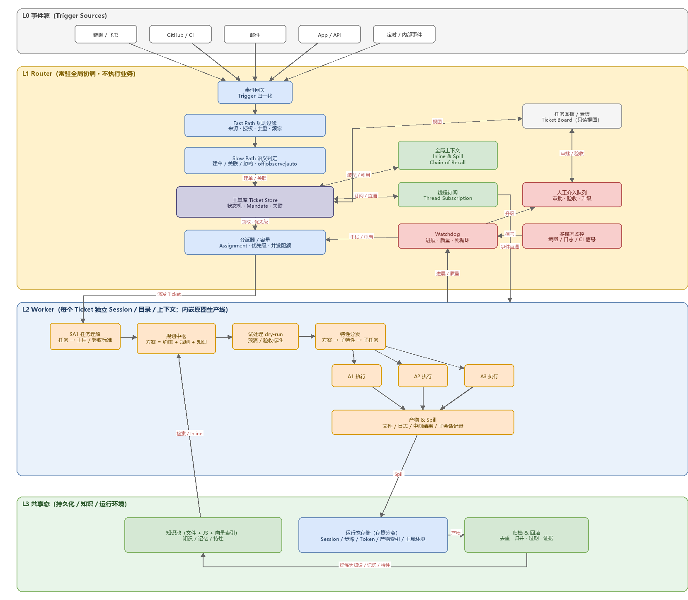

# SuperAgentArea (saa)

**English** · [简体中文](README.zh-CN.md)

> **SuperAgentArea (saa)** is the working name of this fork. The bundle package name, plugin ids and state directory keep the original `dsh-superagent` names so existing installations keep working; a package-level rename is planned with the UI overhaul.

> **Research prototype for reference only, not an official DeepSeek product.** This code grew out of our team's day-to-day development work, with much of the engineering done by coding agents. Treat it as research code, not production-ready software. It may still contain bugs, and its coding style and engineering practices may be inconsistent. Review and adapt it before using it in your own environment.
>
> We have adapted it for publication, so it is not identical to our internal version or the implementation described in *Exploring Super-agent Design: Towards a More Autonomous Agent System*. Some designs discussed in the article are directions for future development and are not implemented in this prototype.

SuperAgentArea is a proactive agent for a team's incoming work, packaged as a bundle for [DeepSeek Harness](https://www.deepseek.com/en/harness/). A new installation starts with one local-folder Source, and GitHub and Feishu are added when needed — each Source kind can run several named instances, each with its own Policy and prompts — admits requests under a versioned Policy, turns authorized ones into Tickets, runs each Ticket in its own agent Session and directory, and delivers the result and its files back to the conversation it came from. A web panel shows what needs a person.

It is also a way of working with an agent: **take as little human attention as possible, and give as much value as possible.** An agent that can act for a whole team can also waste a whole team's attention, so it acts only when asked or when a rule the team wrote allows it, and speaks only when someone must act or can use a result. [docs/000-philosophy.md](docs/000-philosophy.md) explains the principle and what it asks of the operator.

## What it does

- **Listens** to local folder drops by default, and to GitHub (issues, comments, pull requests) and Feishu chats when their accounts are added. A Source *kind* is the reusable implementation; a Source *instance* is one configured listener of it, such as `github:owner/name` or `folder:ops`. The Source catalog lists ten kinds: local folder, GitHub and Feishu are implemented, while Gitee, WeChat, DingTalk, QQ, Telegram, WeCom app and Email are coming soon and only keep their accounts for now.
- **Starts with a local folder.** A new installation seeds one `folder` instance whose inbox and outbox live under the state directory (`<stateDir>/area/local/`), with the OS user as the operator allowed to drop work. It is seeded once: deleting it never brings it back.
- **Decides before it acts.** A rule gate that calls no model filters by source, sender, event type, authorization and duplicates; a model assessment then decides accept, stop, ignore or unavailable on the main Session. Proactive work runs in `off`, `observe` or `auto` mode, and `observe` records what it would have done without doing it.
- **Opens a Ticket, not a chat session.** An accept creates an immutable Mandate — who may ask, how far the work may go — and one Ticket. The Ticket owns its Subscriptions, Inputs, Assignments and artifacts.
- **Works in its own place.** Every Ticket runs in its own Executor Session and directory, follows its production-line prompt, survives a restart, and can be handed back, retried or resumed.
- **Delivers files, not only replies.** A worker writes its deliverables into `deliver/`; on `ready` the Executor promotes and indexes them, names them in the result reply, and the panel downloads them.
- **Shows what needs a person.** Overview, Sources, Workstations, Artifacts and Settings, each Source's own **Policy and prompts** on its card, its page and its account in Settings, and Settings in four groups: the ten Source types with their accounts, Routing and Eval, Executor and environment, and Deployment.

## Architecture: a production line inside a Super-agent

The design grew out of two inputs: a T0–T5 production-line flow for "how one task is broken down, executed and kept", and the Super-agent Router/Worker split for "where work comes from, who authorizes it, how tasks coexist and how a failure recovers". The fusion puts the production line inside the Worker: **the Router decides whether to do it, who does it and how far it may go; the Worker decides how.** The full design is in [plan/Superagent融合架构.md](plan/Superagent融合架构.md).

| Layer | Responsibility | In this repository |
| --- | --- | --- |
| **L0 Event sources** | GitHub/CI, chat, folder drops, timers and internal events, normalized at the edge | `src/sources/` (`github*`, `feishu*`, `folder`, `connectors`) behind one `SourceKind` contract and a `SourceRegistry` of instances |
| **L1 Router** (always on; coordinates, does not do the work) | Trigger normalization → fast-path rules → slow-path assessment → Ticket → dispatch by priority and capacity; subscriptions, context assembly, watchdog, human queue, board | `src/core/` (`Intake`, `Evals`, `Tickets`, `Assignments`, `Replies` behind one `Engine`), `src/policy.ts`, `src/app/passes.ts`, `src/app/outbox.ts` |
| **L2 Worker** (one per Ticket: own Session, directory and context) | Understand → plan → dry-run → split into features → parallel execution → artifacts and spill | `src/executor/dsh.ts`, the worker preset in `cordis.patch.yml`, `prompts/worker.md`, subagents |
| **L3 Shared state** | Knowledge pool, runtime state, archive and write-back, tool environment (storage/compute split) | SQLite `Store`, `<stateDir>/area/` directories, the artifact index. The knowledge pool and archive write-back are not built yet |

**Boundary rule.** The Router never touches business detail: it does not read code or write a solution. The Worker never touches global state: it does not create Tickets and does not change another Ticket. A person appears at three points only: **authorization, review, escalation.**

### The six mechanisms

| Mechanism | Rule | Status here |
| --- | --- | --- |
| Fast Path / Slow Path | Rules filter by source, sender, event type, authorization and duplicates without a model; the model then decides new Ticket, attach to an existing one, or ignore | Implemented: admission table and Policy gate, then Eval on the main Session |
| Ticket + Mandate | A durable Ticket with status, reporter, source, acceptance criteria and artifacts; an immutable Mandate for scope, tools, budget, approver and expiry | Implemented, except token, duration and attempt budgets and leases |
| Thread Subscription | Later messages on a Ticket's Thread reach its Worker directly, with no model decision | Implemented, with hand-back, context-only follows and unsubscribe |
| Inline & Spill / Chain of Recall | Context holds only what the next step needs; the rest spills to files and is recalled by reference: Trigger → Thread → Ticket → Session → Artifact | Partly: compaction, result pruning and `orchestrator_read`; the knowledge-pool side is missing |
| Watchdog | Stall, loop and drift gates, acting by retry → change plan → change Worker → degrade → person | Partly: stall, timeout and model-health checks; the four gates are planned for the governance phase |
| Persistence, recovery, storage/compute split | Runtime state kept beside the knowledge pool; deterministic retries kept apart from semantic retries; a Worker can move machines without losing its Ticket | Implemented: SQLite, durable effects, idempotent outbox, interrupted-Assignment resume |

### What this fork adds on top of the prototype

- **Multi-source, multi-instance.** Every Source kind can run named instances, with per-instance health, setup checks, statistics, configuration and migration. The local folder Source (inbox → `TASK.md` → Ticket → outbox) is the default: a new installation seeds one `folder` instance under `<stateDir>/area/local/`, with the OS user's drops allowed. The Source catalog holds ten kinds — local folder, GitHub, Feishu, and the coming-soon Gitee, WeChat, DingTalk, QQ, Telegram, WeCom app and Email, whose accounts can be saved but receive nothing yet.
- **Per-Source Policy and prompts.** Every Source instance owns its accept rules and its prompt configuration, edited from the **策略提示配置 (Policy and prompts)** action on its card or page; an unsaved instance inherits the installation default. Each worker reads its Ticket's Source configuration and its kind's default skill, while the main Session reads the installation default plus every configured kind's default skill. A new Source kind ships its own skill in `skills/dsh-superagent-<kind>/SKILL.md`.
- **Projects (workstations) as first-class objects.** Work belongs to a station. A request whose station is unknown is refused by Eval and asked back (`needsProject`), answered by a person, then evaluated again; the built-in `workspace` takes work no station owns.
- **Artifacts as first-class results.** Delivered files are collected on `ready`, promoted into the station's output directory, indexed with hash and size, delivered as files or links, downloadable from the panel, and traceable **Artifact → Ticket → Assignment → worker Session**.
- **A panel rebuilt around work.** Overview, Sources, Workstations, Artifacts and Settings, each Source's own Policy and prompts, Settings in four groups (Source types and their accounts, Routing and Eval, Executor and environment, Deployment), plus a project Session and the history a Project collects.
- **A bilingual UI** (Chinese and English) and the directory model `<stateDir>/area/{workspace,<station>,<station>.work}`: final deliverables in the station, working copies in its sibling.

## Status

Version **0.3.5**. Phases P1–P6c are complete — schema 12, Source instances, project attribution, the Sources, Workstations and Artifacts pages, project Sessions and history, and the closing pass — and **0.3.0** passed the desktop end-to-end flow. **0.3.1** moves Policy and prompts under each Source instance: every Source owns its rules and its prompt configuration, and each Source kind ships its own default skill. **0.3.2** gives that configuration its own page with a **Policy** and a **Prompts** tab. **0.3.3** adds the **Settings** tab with the ten Source types and their accounts, a two-step add-source flow, a default local-folder Source seeded once, and the delete-source API. **0.3.4** keeps Feishu in the catalog, so all ten types are listed, and **0.3.5** lays the add-source type picker out as a compact four-column grid. `pnpm check` runs green with more than 1,300 tests. What is next is recorded in [plan/21-实施总结.md](plan/21-实施总结.md): IM and remote Sources (DingTalk, QQ, SFTP, S3), repository worktree execution, the L2 production-line prompts and skills, governance (Watchdog gates, budgets and leases, sandboxing), and the knowledge pool.

## Releases

Every packaged build is archived with its SHA-256, source commit and a change comparison in [releases/README.md](releases/README.md) (machine-readable: [releases/manifest.json](releases/manifest.json)). The `.tgz` files stay in the repository root, so a version can be reinstalled, or checked out and rebuilt for further development. See the compatibility notes before rolling a migrated state directory back to 0.1.x.

## Setup

Setup has many steps, so an agent does it with you. Ask your coding agent:

> Read SETUP.md in this repository and set up dsh-superagent with me.

It asks one short question at a time, shows the full plan once, and then installs and configures everything. [SETUP.md](SETUP.md) is what it follows.

## Documentation

Product documentation reads in order; each numbered document builds only on the ones before it.

- [000 Philosophy](docs/000-philosophy.md)
- [001 Domain model](docs/001-domain.md)
- [002 Authorization](docs/002-authorization.md)
- [003 Execution](docs/003-execution.md)
- [004 Prompts](docs/004-prompts.md)
- [005 Panel](docs/005-panel.md)
- [006 Deployment](docs/006-deployment.md): manual setup, configuration, upgrades and troubleshooting
- [007 Architecture](docs/007-architecture.md)
- [008 Cookbook](docs/008-cookbook.md): adding a Source

The design archive records how this fork was designed and built, phase by phase. It is written in Chinese:

- [Design archive index](plan/README.md)
- [Fusion architecture](plan/Superagent融合架构.md): the four-layer design this repository follows, with the editable diagram `plan/Superagent融合架构.drawio`
- [Overall plan](plan/00-总体方案.md): the gap analysis against the prototype and the phase plan
- [Workstations and artifacts](plan/10-工作站与产物设计方案.md): the frozen v1.0 design of the panel and the domain model
- [Implementation summary](plan/21-实施总结.md): the P1–P6 commits, verification and known limits
- [Per-Source Policy and prompts](plan/22-工单源策略与提示词.md): moving Policy and prompts under each Source instance, with the implementation record

## Development

`pnpm check` runs the typecheck, the tests and the build.

## License

[MIT](LICENSE)
