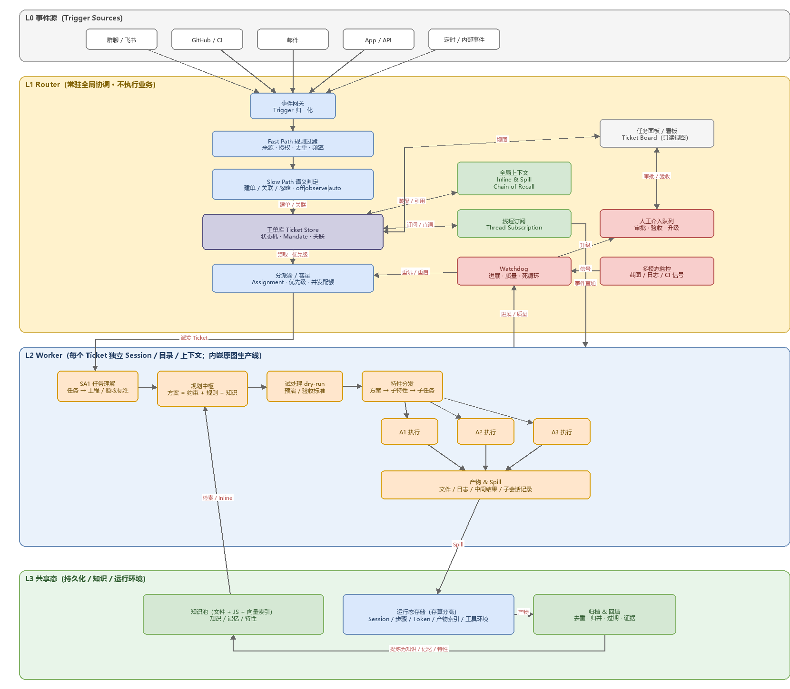

# SuperAgentArea（saa）

[English](README.md) · **简体中文**

> **SuperAgentArea（saa）** 是本分支的工作名。bundle 包名、插件 id 与状态目录仍沿用上游的 `dsh-superagent` 命名，保证已装实例继续可用；包级更名计划随界面大改一起发布。

> **仅供研究参考的原型，不是 DeepSeek 官方产品。** 这份代码源自团队日常开发，其中大量工程由编码智能体完成。请把它当作研究代码而非生产可用软件：它可能仍有缺陷，代码风格与工程实践也可能不一致，请在自有环境中审阅并改造后再使用。
>
> 为公开发布，我们做过适配，因此它与我们的内部版本、也与《Exploring Super-agent Design: Towards a More Autonomous Agent System》描述的实现在若干处并不相同。文中讨论的某些设计属于后续方向，本原型尚未实现。

SuperAgentArea 是面向团队「进来的一摊活」的主动式智能体，以 [DeepSeek Harness](https://www.deepseek.com/en/harness/) 的 bundle 形式交付。它监听 GitHub、飞书与本地文件夹——每一种来源（Source kind）都可以开多个具名实例——按版本化的策略（Policy）判断请求是否准入，把获准的请求变成工单（Ticket），让每个工单在自己的智能体会话与目录里执行，再把结果与文件送回它来自的那个会话。Web 面板只展示需要人处理的事。

它也是一种与智能体协作的方式：**占用尽量少的人类注意力，产出尽量多的价值。** 一个能替整个团队行动的智能体，也可能浪费整个团队的注意力，所以它只在被请求、或团队写下的规则允许时才行动，只在需要人做决定、或有人能用上结果时才发言。[docs/000-philosophy.md](docs/000-philosophy.md) 说明了这条原则以及对运维者的要求。

## 它能做什么

- **监听** GitHub（issue、评论、pull request）、飞书群聊与本地文件夹投件。来源 *kind* 是可复用的实现，来源 *实例* 是它的一个具体监听配置，例如 `github:owner/name`、`folder:ops`。
- **先判断再行动。** 不调模型的规则门禁按来源、发送人、事件类型、授权范围与去重先筛一遍；再由模型在主 Session 上判定「接单 / 停止 / 忽略 / 未完成」。主动工作分 `off`、`observe`、`auto` 三档，`observe` 只记录「本来会做什么」，不真的做。
- **开的是工单，不是聊天会话。** 接单会同时生成一份不可变授权（Mandate，说明谁可以提、这件事能做到哪一步）和一个工单；工单持有自己的订阅、输入、派工与产物。
- **在自己的地方干活。** 每个工单跑在独立的执行器 Session 与目录里，按生产线提示词工作，能跨重启恢复，也能交还、重试或续做。
- **交付文件，而不只是回帖。** worker 把交付物写进 `deliver/`；报 `ready` 时执行器把文件提升、建立索引、在结果回复里点名，面板可直接下载。
- **只展示需要人的事。** 概览、工单源、工作站、产物四个工作页，加上一级的提示词与策略页，设置收在顶栏齿轮里。

## 架构：把生产线装进 Super-agent

这套设计由两个输入合成：一是 T0–T5 的「生产线」流程，回答「一个任务怎么被拆开、执行、沉淀」；二是 Super-agent 的 Router/Worker 双层，回答「任务从哪来、谁授权、多任务怎么并存、失败了怎么恢复」。融合的结论是：**把生产线整体降为 Worker 的内部流程——Router 管「要不要做、谁来做、到哪了」，Worker 管「怎么做」。** 完整设计见 [plan/Superagent融合架构.md](plan/Superagent融合架构.md)。

| 层 | 职责 | 在本仓库的落点 |
| --- | --- | --- |
| **L0 事件源** | GitHub/CI、群聊、文件夹投件、定时与内部事件，在边缘完成归一化 | `src/sources/`（`github*`、`feishu*`、`folder`）实现同一份 `SourceKind` 契约，由 `SourceRegistry` 管理实例 |
| **L1 Router**（常驻；只协调，不执行业务） | Trigger 归一化 → Fast Path 规则 → Slow Path 评估 → 建单 → 按优先级与容量派工；订阅、上下文装配、看门狗、人工队列、看板 | `src/core/`（`Intake`、`Evals`、`Tickets`、`Assignments`、`Replies`，统一暴露为一个 `Engine`）、`src/policy.ts`、`src/app/passes.ts`、`src/app/outbox.ts` |
| **L2 Worker**（每工单一个：独立 Session、目录与上下文） | 理解 → 规划 → 试处理 dry-run → 特性分发 → 并行执行 → 产物与 Spill | `src/executor/dsh.ts`、`cordis.patch.yml` 里的 worker preset、`prompts/worker.md`、subagent |
| **L3 共享态** | 知识池、运行态、归档与回填、工具环境（存算分离） | SQLite `Store`、`<stateDir>/area/` 目录、产物索引；知识池与归档回填尚未实现 |

**边界原则。** Router 不碰业务细节：不读代码、不写方案。Worker 不碰全局状态：不建单、不改别的工单。人只出现在三个点：**授权、验收、升级。**

### 六个机制

| 机制 | 规则 | 本仓库状态 |
| --- | --- | --- |
| Fast Path / Slow Path | 规则按来源、发送人、事件类型、授权与去重做不调模型的筛选；再由模型判定「建新单 / 关联已有单 / 忽略」 | 已实现：admission 表 + 策略门禁，其后进入主 Session 的 Eval |
| Ticket + Mandate | 持久化工单（状态、汇报人、来源、验收口径、产物）+ 不可变授权（范围、工具、预算、批准人、有效期） | 已实现；token/时长/次数预算与租约未做 |
| Thread Subscription | 工单所在 Thread 的后续消息直通它的 Worker，不再过模型判定 | 已实现，含交还、仅上下文订阅与退订 |
| Inline & Spill / Chain of Recall | 上下文只放下一步要用的，其余落到文件、按引用回捞：Trigger → Thread → Ticket → Session → Artifact | 部分实现：compaction、结果裁剪与 `orchestrator_read`；知识池一侧未做 |
| Watchdog | 无进展、循环、偏航三类门禁；动作按 重试 → 换方案 → 换 Worker → 降级 → 人工 递进 | 部分实现：停滞、超时与模型服务健康检查；四类门禁属于治理阶段 |
| 持久化、恢复、存算分离 | 运行态与知识池分开；确定性重试与语义重试分开计次；换机器不丢工单 | 已实现：SQLite、持久化 effect 队列、幂等 outbox、中断派工恢复 |

### 本分支在原型之上补了什么

- **多来源、多实例。** 每种来源 kind 都能开多个具名实例，各自有健康条目、Setup 校验、统计、配置与迁移。新增本地文件夹来源（inbox → `TASK.md` → 工单 → outbox）。
- **项目组（工作站）成为一等对象。** 活归属于工作站；项目未注册时由 Eval 拒绝并反问（`needsProject`），人回答后重新评估；内置 `workspace` 承接无归属的临时工单。
- **产物成为一等结果。** 交付文件在 `ready` 时收集、提升到工作站成果目录、按 hash 与大小建索引、随结果回复交付、面板可下载，并可 **产物 → 工单 → 派工 → worker Session** 逐级反查。
- **面板按「活」重建。** 概览、工单源、工作站、产物四个工作页，提示词与策略提升为一级页，另有项目会话与项目历史。
- **中英双语界面**，以及 `<stateDir>/area/{workspace,<station>,<station>.work}` 目录模型：成果进工作站，副本留在同级副本目录。

## 状态

当前版本 **0.3.0**。P1–P6c 已全部完成：schema 12、来源多实例、项目归属前置、工单源/工作站/产物三个页面、项目会话与历史、以及收口项。`pnpm check` 全绿，测试 1300 余项；0.3.0 已通过桌面端真实 E2E。后续工作记录在 [plan/21-实施总结.md](plan/21-实施总结.md)：IM 与远程来源（钉钉、QQ、SFTP、S3）、仓库站的 worktree 执行、L2 生产线提示词与技能、治理（看门狗门禁、预算与租约、沙箱）、知识池。

## 安装

安装步骤较多，由智能体带着你完成。对你的编码智能体说：

> Read SETUP.md in this repository and set up dsh-superagent with me.

它一次只问一个短问题，最后把完整计划给你看一遍，确认后再安装配置。[SETUP.md](SETUP.md) 是它执行的清单。

## 文档

产品文档按顺序阅读，每篇只建立在前几篇之上。

- [000 设计哲学](docs/000-philosophy.md)
- [001 领域模型](docs/001-domain.md)
- [002 授权](docs/002-authorization.md)
- [003 执行](docs/003-execution.md)
- [004 提示词](docs/004-prompts.md)
- [005 面板](docs/005-panel.md)
- [006 部署](docs/006-deployment.md)：手工安装、配置、升级与排障
- [007 架构](docs/007-architecture.md)
- [008 扩展指南](docs/008-cookbook.md)：新增一种来源

设计档案记录了本分支是怎么一步步设计与实现的（中文）：

- [设计档案索引](plan/README.md)
- [融合架构](plan/Superagent融合架构.md)：本仓库遵循的四层设计，可编辑源图在 `plan/Superagent融合架构.drawio`
- [总体方案](plan/00-总体方案.md)：与原型逐条核实的差距分析与阶段计划
- [工作站与产物设计](plan/10-工作站与产物设计方案.md)：面板与领域模型的 v1.0 冻结设计
- [实施总结](plan/21-实施总结.md)：P1–P6 的提交、验证与已知限制

## 开发

`pnpm check` 依次跑类型检查、测试与构建。

## 许可

[MIT](LICENSE)
