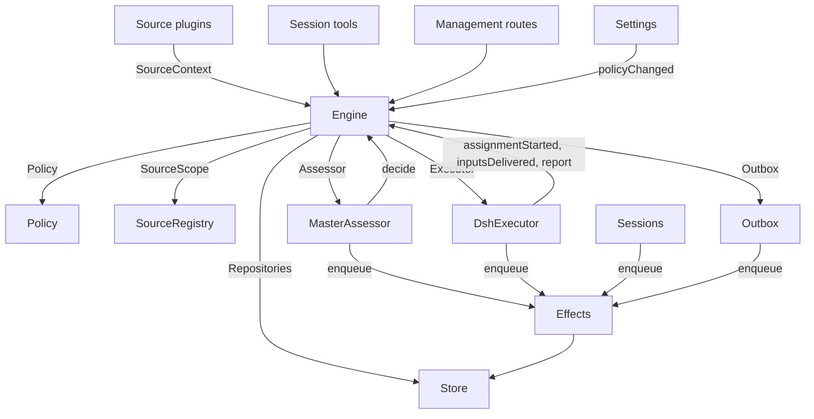

# 007 Architecture

This is the developer guide to the implementation. It maps the concepts in [001 Domain model](001-domain.md) through [006 Deployment](006-deployment.md) to classes, interfaces and files. Start with the runtime and Engine, then use the module and test tables as a code index.

## Core classes and glue

Core classes own domain concepts and external boundaries behind small interfaces. Glue translates tool arguments, HTTP requests, Source payloads and DeepSeek Harness events into calls to those classes, then turns results into cards, views and messages.

`Runtime` (`src/app/runtime.ts`) constructs the application, supplies dependencies, and owns startup and shutdown. `Engine` constructs its own internal parts. The Executor and Assessor call back into the Engine, so Runtime gives them getters rather than requiring construction in a circular order; Prompts also reads the configured Source instances through a getter, so an instance added at runtime is seen without rebuilding it.

### Runtime

`Runtime` is the composition root; it contains no domain rules. Its constructor locks the state directory, opens the Store and builds each component. If construction fails, it closes the Store and releases the lock.

Startup registers management routes and runs Setup. After setup resolves, it installs Session and Executor hooks, ensures the main Session exists, starts Policy syncs, resumes interrupted Assignments, and starts passes and effects. `ready` marks completion of startup. The plugin entry then calls `ensureDefaults` (`src/app/defaults.ts`) once, which seeds the default local folder Source on an installation that has none and records it in KV; the constructor never seeds, and a failure leaves no record so the next start retries.

Shutdown cancels turns, waits for passes, effects and agents, restores the process environment, closes the Store and releases the lock. Source plugins inject Runtime as the `orchestrator` service through the narrow `SourceHost` interface.

| Part | Module | Does |
| --- | --- | --- |
| Setup | `src/app/setup.ts` | Resolves the repository and the accounts by probing their CLIs the way worker shells run them, writes and applies the workers' environment and command shims, and keeps the setup problems; an installation whose GitHub Source names no repository resolves no GitHub account and verifies no credential helper; each enabled named GitHub or Feishu instance is checked with its own CLI and repository, and its failure is that instance's problem rather than a setup failure; Settings checks a changed account through it, and restarts through it, which runs setup again |
| Passes | `src/app/passes.ts` | One pass at a time, every two seconds and whenever a command asks: the due effects, then `Engine.evaluateDue`; a Source's Trigger reaches the Engine through it |
| Outbox | `src/app/outbox.ts` | The Engine's `Outbox` port, and the only writer of the receipts: `send` keeps a message's receipt and queues its `reply` effect in one transaction, and the effect's handler sends it through `SourceRegistry.send`; a message waits while its Source is off, and is dropped when the conversation is gone or not listened to |
| Notices | `src/app/notices.ts` | Converts domain events and worker activity into main-Session messages. `eventNotice` handles domain notices; `reportRelay` forwards questions immediately, keeps ordinary progress on its Ticket, and relays other reports; `followupRelay` names the Tickets that own a human follow-up. Relays arriving during a turn are delivered together at its next step through the DeepSeek Harness inbox |

### Engine

`Engine` (`src/core/engine.ts`) is the only writer of Triggers, Threads, Decisions, Tickets and Assignments. It receives these ports from `src/core/ports.ts`: `Repositories`, a current-Policy getter, `SourceScope`, `Assessor`, `Executor` and `Outbox`. Optional dependencies are `prepareTicket`, `now` and `emit`.

All Engine methods are synchronous. Each command changes its aggregates in one transaction. `evaluateDue` uses a separate transaction for each Eval or Ticket it changes. Ports enqueue external work inside the transaction; adapters perform it after commit. Invalid requests throw `UserError`.

The Engine exposes one entry point and delegates to five internal parts. It owns each command's transaction. Commands spanning parts, such as `attach`, `evaluateDue` and `policyChanged`, call the parts in sequence.

Each part extends `EnginePart` (`src/core/part.ts`), which provides options and shared reads. Dependencies between the parts flow in one direction:

| Part | Responsibility | Depends on |
| --- | --- | --- |
| `Intake` | A Source's Trigger: stored once with its disposition, recorded on its Threads and their correlations, fanned out to the subscribed Tickets and, unless it is a person's message that reached one, queued for Eval on its primary Thread | Tickets |
| `Evals` | The Evals of Threads: batching, the gate's strength, actor and basis with the Trigger that gave them (`primary`), the deadline from the candidate's delivery and its shift by a pause, the requeue of an expired Eval, candidates, replays and hand-backs, the requeue on a Policy change, and the Decision each ends with: accept, stop, ignore or unavailable | Tickets |
| `Tickets` | The Ticket lifecycle: creation from an accept with its Mandate, Subscriptions and first Assignment, the Threads it follows and their closes (`followsDone`), attached Threads and Threads followed for context, Inputs and notes, resume and the messages a resume refuses, retry, restart, stop and end, the Subscriptions it drops, and the notice of a Policy change to the Tickets it bears on | Replies |
| `Assignments` | What the Executor and its workers report: an Assignment started, Inputs reached it or failed to, a restart interrupted it, and a worker's Report with its question for a person | Tickets, Replies |
| `Replies` | Channel writes through the `Outbox`: the acknowledgement, the answer, the result, the attention message and the host's own question about a Trigger's Project, each by the rule that allows it | Nothing |

Commands use imperative names such as `stopTicket`; facts reported by adapters use past-tense names such as `assignmentStarted`. The query `candidate` uses a noun.

Callers receive only their role's `Pick` of the Engine: `EngineForSources`, `EngineForMainSession`, `EngineForPeople`, `EngineForSettings` or `EngineForExecutor`.

| Role | Method | Effect |
| --- | --- | --- |
| Sources | `receive(trigger)` | Stores a Trigger once and answers `stored`, `duplicate`, or `filtered` when no Source receives it; fans it out to the Tickets subscribed to its Threads, where a person's message resumes an ended Ticket at once unless processing is paused, and queues it for Eval on its primary Thread, unless it is a person's message that reached a Ticket, which stays that Ticket's |
| Sources | `bindThread(ticketId, thread, own)` | Makes an open Ticket follow one of the Source's Threads, such as a pull request's, `own` when the Ticket opened it; a closed Thread bound again is open again. The Threads' closes, not a `ready` Report, end the Ticket |
| Sources | `threadClosed(thread, outcome, at)` | A Thread closed: each open Ticket that follows it records the close, and ends once it is done with the Threads it follows (`followsDone`): no Thread it opened is open, or, when it opened none, every Thread it follows closed. It ends `merged` or `closed` as the latest of those closes did, unless work resumed after the close has not reported `ready`, or its Executor took up, by acknowledging or answering it, a person's follow-up it decides after its latest Report other than `progress`, or the end of its last turn; a `dropped` Report then ends it as the close did |
| Main Session | `candidate(triggerId)` | The Eval that holds a Trigger, as its assessor sees it |
| Main Session | `candidateDelivered(evalId)` | The Eval's candidate reached the main Session: its deadline counts from now |
| Main Session | `decide(triggerId, outcome)` | Records an Eval Decision, or a direct Decision for an explicit request. Accept creates the Ticket, Mandate, Assignment, Subscriptions and acknowledgement atomically. An inferred candidate ignored from its card records `ignoredFromCard` before the supplied reason. While `followupOwners` still owns a human follow-up, only stop is allowed |
| Main Session | `attach(ticketId, triggerId, note?)` | Routes a Trigger to a Ticket it points at, whose Executor then decides it as a follow-up, and ends the Eval that holds it, whose other Triggers wait for a fresh Eval; an ended Ticket resumes under its Mandate at once unless processing is paused. A follow-up an Executor still decides is refused, as is one routed back to the Ticket that handed it back |
| Main Session | `requestStatus(ticketId)` | Asks a waiting Executor Session for its status, and answers whether it asked |
| Main Session | `note(ticketId, text)` | Gives a Ticket's Executor a fact from other work as a text Input, which grants nothing |
| Main Session, Executor | `reply(request)` | Queues a message for the Channel its purpose names: `acknowledgement`, `answer`, `result` or `attention` |
| People | `stopTicket(ticketId, reason?)` | A person's stop, which withdraws the Mandate |
| People | `retryTicket(ticketId)` | Ends the stalled Assignment of a Ticket that waits for a person after a `failed` or `blocked` Report, or whose Input delivery failed (`canRetry`), and starts a new one |
| People | `reevaluate(triggerId)` | Queues a stored Trigger for a fresh Eval |
| People | `unsubscribe(thread)` | Drops every Subscription on a Thread, and the Tickets that followed it follow it no more; each keeps deciding the follow-ups it received there |
| People | `dismiss(decisionId)` | Dismisses the problem an `unavailable` Decision shows, which the Decision records |
| Executor | `assignmentStarted(ticketId, assignmentId)` | An Assignment runs; its waiting Inputs go out |
| Executor | `inputsDelivered(ticketId, assignmentId, inputIds)` | Inputs reached the Assignment's Executor Session, where each waits for a step to take it |
| Executor | `inputsRead(ticketId, inputIds)` | The Executor Session took the messages that carry these Inputs into its history (a `user/message` Session event), from which its model has them; a step that claimed them and was cancelled or failed before does not count. Each counts as read once a Report or the end of a turn follows, also after a restart, and its Ticket's end does not let go of it; an Input delivered before reads were recorded counts as read once a Report or the end of a turn followed its delivery |
| Executor | `turnEnded(ticketId, assignmentId)` | A turn of the Executor Session ended, also after a Report, once nothing runs for it in the background or as it hands off to a person. What a step took before, it read (`inputsRead`) |
| Executor | `deliveryFailed(ticketId, assignmentId, error)` | Delivering Inputs failed; the Ticket shows it until a delivery succeeds, a new Assignment starts or the Ticket ends |
| Executor | `report(ticketId, report)` | Records a Report and its question for a person; `dropped` ends the Ticket, and `ready` completes one that follows no Thread, and ends one done with the Threads it follows as they ended |
| Executor | `markUnrelated(ticketId, thread, reason)` | Drops only that Ticket's Subscription to an attached Thread it found unrelated, and hands back, with the reason, the follow-ups there that the Ticket decides |
| Executor | `followForContext(ticketId, thread)` | Subscribes an open Ticket to a related Thread for context: its messages reach the Ticket but lend it no follow-up strength and do not resume it |
| Executor | `handback(ticketId, triggerId, reason)` | Records that the Ticket hands back a Trigger that reached it, with the reason its candidate carries, and queues it for a fresh Eval once no other Ticket decides it, if this Ticket did; it answers whether it queued it. A Ticket hands back each Trigger once and keeps its Subscription |
| Executor | `assignmentInterrupted(ticketId, assignmentId)` | An Assignment was running when the host stopped: one interrupted mid-work, or one that received an Input after its latest Report, starts again with a recovery note and the Inputs delivered to it that its Executor Session did not take, as a retry does; one that had reported since keeps its Session. The DshExecutor reports each at start (`resume`), oldest Ticket first, and queues again a launch that waits |
| Passes | `evaluateDue()` | Unless processing is paused: starts the Evals of the Threads whose queued Triggers wait, one per Thread with the Triggers queued meanwhile as one batch; queues the Triggers of an Eval past its deadline again, twice in a row, and records it `unavailable` the third time; and resumes the ended Tickets a person's message reached during a pause, if their Mandates still hold. An Eval whose candidate has not reached the main Session does not expire. While processing is paused, no Eval expires, and once it resumes each deadline moves later by the pause's length |
| Settings | `policyChanged(from, to, effects)` | Tells each live Ticket the change bears on how (`policyEffects` in `src/policy.ts`, which compares the rules of each Ticket's own Source instance: a rule it was accepted under changed or no longer applies, its requester may no longer start work, or proactive work is no longer accepted), and restarts the Evals in progress under the new version |

The Engine keeps batching, authorization, fan-out, resume and attention lifecycle rules private. Several shared predicates make these rules consistent:

- `waitsForPerson` (`src/core/model.ts`): the latest Assignment reported `blocked` or `failed`, and no human message has arrived since. Automatic Inputs and failed launches remain held while this is true.
- `followupOwners`: the Tickets still responsible for a human follow-up received on their own Threads. A Ticket can be live or ended without a human stop and waiting to resume. Handing back the message ends that ownership.
- `settled`: a Decision resolved the request; stop, unavailable, routed and refused-stop Decisions do not count.
- `ticketStage` (`src/core/stage.ts`): implements the stage table in [003 Execution](003-execution.md).

When a Ticket ends, unread follow-ups return to Eval unless another Ticket still owns them or another disposition settled them. Acknowledged, answered and handed-back messages are excluded. For older records without acknowledgement dispositions, the outbox receipt supplies that fact. A final Report also covers messages waiting when the Assignment began, including the message that resumed it. The message that stopped a Ticket is not automatically re-evaluated.

After a change, the Engine emits an event from `DomainEvents` in `src/core/ports.ts`:

`trigger.received`, `eval.started`, `decision.recorded`, `ticket.created`, `ticket.resumed`, `ticket.ended`, `assignment.started`, `assignment.ended`, `thread.subscribed`, `thread.unsubscribed`, `trigger.requeued`, or `policy.changed`.

Runtime turns `ticket.ended`, `trigger.requeued` and `thread.unsubscribed` into notices. A human `trigger.received` delivered to Tickets becomes a follow-up relay. `pullEndNotices` sends one chat notice, using a stable id, when a Ticket ends merged or closed; `ticketCardNotice` sends one when a Ticket starts, naming its reporter and mentions. Other events currently have no consumer.

### Model

`src/core/model.ts` holds the domain types, and `src/core/stage.ts` the Ticket stages. A Decision records why as `reason`, a list of `Reason`s (`src/core/reasons.ts`): each a `code` with its `values` and, for one Trigger of a batch, its `triggerId`.

The core's codes, such as `timeout`, `policyChanged`, `routed` and `startedTicket`, are `REASONS`, with the English that agents read through `reasonText`; a gate or a Source scope gives its own, such as `not_a_member`; and `said` carries words an assessor or a person wrote. The panel words each code by `reason.<code>`, and a Trigger a Source filtered records the Source's code the same way.

A Ticket keeps each fact once. It is open while it has no `ended`, which records when, by whom, why and with what outcome it ended; what it last said is its latest Assignment Report (`latestReport`); and its Executor Session is named after it (`workerSessionId` in `src/executor/dsh.ts`).

Its fields are typed: `origin`, the admissible Trigger that gave its Eval's batch its strength and the batch itself (`triggerId`, `triggerIds`); `projectId` and `sourceId`, the Project and Source instance it belongs to; `reporter` and `mentions`, the people it is for and names, as each Source knows them; `execution`, what the Executor chose (`name`, `directory` and `assignment`); `delivery`, the last failed Input delivery (`error`, `at`), until a delivery succeeds, a new Assignment starts or the Ticket ends; and `follows`, the Threads a Source made it follow, each `{thread, own, closed?}`: `own` when the Ticket opened it, and `closed` with `at` and `outcome` once it closed. Tickets alone writes `follows`; the GitHub Source reads its pull requests with `pullsOf` and `pullOf` (`src/sources/github-pull.ts`).

An Input that carries a Trigger records whether a person wrote it, which `waitsForPerson` reads. A Thread also lists in `context` the subscribed Tickets that follow it only for context, and counts in `expired` the Evals of its queued Triggers that expired in a row; an Evaluation records its `primary` Trigger and when its candidate was `delivered`.

A Trigger's disposition records the Tickets it reached, by fan-out or attachment, a person's requeue, each Ticket that handed it back, with the reason, and each Ticket whose Executor acknowledged or answered it.

A Mandate's `basis` (`MandateBasis`) records how the gate admitted its Trigger. Revalidation reads the receiving `source`, `scope` and `row`, the listed `sender`, matched `rules`, and `via`:

| `via` | Admission basis |
| --- | --- |
| `addressed` | An allowed sender addressed the agent |
| `followup` | A message arrived on a Thread with Tickets |
| `admission` | An admission-table cell; `observation` marks an inferred candidate |
| `bot` | A listed bot produced an inferred candidate |

Trigger and Thread `meta` belong to the Source. The core does not interpret them.

### Policy

`src/policy.ts` defines settings schemas, authorization and assessment rules. `settingsPolicy(settings, scope)` returns a fresh, stateless `Policy` on each use:

- `version`, `paused` and `evalTimeoutMs` describe its current state.
- `gate(trigger, thread, tickets)` returns admission strength and basis, from the receiving Source instance's `allowed`, `bots` and admission table.
- `revalidate(mandate)` checks whether an existing Mandate still holds, using the rules that apply to its Source instance.
- `admitsInferred(rules, source)` permits proactive acceptance only in auto mode with the enabled matching rules of `source`.

`rulesFor(settings, source)` returns the rules that apply to work from a Source instance: the instance's own `rules` when it saved any, else the installation's default `policy.rules`. That is why a Source's own rules replace the default for its work alone, with no data migration for an installation that never saves one. `assessmentOutcome(assessment, settings, strength, source)` converts the model's assessment to an Engine outcome; it requires a judgement for every enabled rule of the candidate's Source, settled direction, a matching rule and evidence of intent. Outside auto mode, an inferred accept becomes a “would accept” record. `Evals` passes the Trigger's Source to `admitsInferred`, so a matched rule that exists only on another Source cannot accept.

`policyEffects(tickets, old, now, scope)` identifies which open Tickets a change affects and how; for each Ticket it compares the rules of that Ticket's Source before and after (`rulesFor`), and a Source-level change therefore reaches only the work of that Source. `Engine.policyChanged` notifies only those Tickets. `policyVersion` hashes the installation's default rules, accept mode and every Source's Policy part, including an instance's own rules and bot lists.

A Source instance's Policy is saved as the settings block `policy:<id>`. Its `admission`, kind-specific fields and optional own `rules` are validated by the Policy schemas and its kind, and stored in `settings.policy.sources[id]`.

### Store

`Store` (`src/app/store.ts`) owns one SQLite database. Runtime acquires the directory lock before opening it, preventing a second process from migrating or writing the same state.

Its interfaces are grouped by purpose:

- **Domain repositories:** `atomic`, plus `triggers`, `threads`, `tickets` and `decisions`, each with `get`, `save` and list queries. Indexed working sets are `threads.active()`, `tickets.open()`, `tickets.active()` and `read.subscribedThreads`.
- **Projects and artifacts:** `projects` (`get`, `byKey`, `list`, `save`, `ensureWorkspace`), whose built-in workspace Project the schema 12 migration creates, and `artifacts` (`get`, `add`, `listByTicket`, `list`), the index of delivered files.
- **Read queries:** `read` serves views, tools and Source polls through methods such as `threadTriggers`, `triggerStats`, `search` and `droppedReplies`. These methods never write.
- **Source metadata:** `threads.describe` and `threads.patchMeta` update Source-owned Thread metadata.
- **Settings:** `settings`, `saveSettings`, `blockRevision` and `settingsHistory`. A block revision exists for each block, including a Source instance's configuration (`source:<id>`) and its Policy (`policy:<id>`). Settings and prompts use numbered `Versions` (`src/app/versions.ts`); prompts keep one numbered chain per scope, the installation default and each Source instance.
- **Outbox receipts:** `replyStatus` and `receipts`, written only by Outbox. Receipt operations are `get`, `waiting`, `behind`, `add`, `settle` and `withdraw`. `behind` checks whether an earlier message for the same Ticket and conversation is waiting with fewer than three failures. A withdrawn message settles with `channelGone` or `channelIgnored`. Read queries expose failed and dropped replies through `failingReplies`, `droppedReplies` and `droppedSince`.
- **Typed key-value records:** `get`, `set`, `delete` and `keys`, using entries from `KV`.

`afterCommit` runs an action only after the transaction commits, never after rollback. Runtime reads records in their stored shape; the schema 12 migration converts older supported records at startup.

### Effects

`Effects` (`src/app/effects.ts`) is the durable side-effect queue. A command calls `enqueue(kind, key, payload)` inside its transaction; execution begins only after commit.

Each kind/key pair has one row. Enqueuing the same waiting key replaces its payload and makes it due immediately without changing queue order. `handle(kind, run, options)` registers one handler per kind. It processes due rows oldest first, up to the concurrency limit.

Failures retry with exponential backoff. Throwing `Later` defers work without counting a failure, for example when no worker slot is available. `start` begins processing after setup, `drain` stops it during shutdown while preserving pending rows, and `pending`/`idle` expose queue state.

| Kind | Handler | Does | At once | Retry |
| --- | --- | --- | --- | --- |
| `assessment` | MasterAssessor | Steers an Eval's candidate card into the main Session's turn, then tells the Engine it was delivered, which starts the Eval's deadline | 4, none while paused | 2 s doubling to 60 s |
| `launch` | DshExecutor | Launches a pending Assignment: prepare command, Executor Session, assignment message | The free worker slots, none while paused | A passing failure of the model provider or the network runs again after 5 s doubling to 300 s, three times; any other failure, and a failed prepare command, fails its Ticket. One held by a pause or by full worker slots tries again after 5 s |
| `delivery` | DshExecutor | Hands a Ticket's waiting Inputs to its running Assignment, in order | 4, none while paused | 2 s doubling to 60 s; one that waits for a worker slot tries again after 2 s |
| `relay` | Sessions | Steers a worker's report or question, or a person's follow-up, into the main Session's turn | 1, in queue order | 2 s doubling to 60 s |
| `notice` | Sessions | Injects a notice into the main Session without waking it | 1, in queue order | 2 s doubling to 60 s |
| `reply` | Outbox | Sends a message for a Channel through its Source, after the earlier messages of its Ticket to its conversation that have not failed three times; withdrawing the message cancels it | 1, none while paused | 5 s doubling to 300 s; one whose Source is off, or behind an earlier message, tries again after 5 s |

Each kind has a health entry under its name. It reports an error once one of its effects failed three times in a row, except `delivery`, whose failures show on their Ticket instead. Relays keep their order, and so do notices; a failed one holds back the later ones of its kind.

### Sources

Sources extend the host through `SourceKind`, defined in `src/sources/kind.ts`. A kind declares its identity, title, description, configuration `schema` and `fields` (one instance's configuration), derived `facts`, and `health` entries: the entry named after the kind also serves a stored instance named after it, any other declared entry is kind-wide, and each instance also reports an entry named by its own id. A `placeholder: true` kind is listed and saves accounts, but receives and sends nothing yet, and the views show its instances paused with the fixed `placeholder` health code. Optional behavior includes `scope` (which receives the instance id), a `channel` (`allowed`, `send`, `link`), `commands` (the shared CLI commands adapted to the instance's own repository and CLI), `threadContext`, `find`, `policy`, `environment` and `refreshLabels`.

`SourceRegistry` (`registry.ts`) owns registered kinds and the configured instances of each, and implements the Engine's `SourceScope`. An instance id is the bare kind for a database that predates instances, and `<kind>:<key>` for a named one (a folder's `folder:<row id>`, a GitHub repository's `github:<repository>`); `kindOf(source)` resolves a Trigger's, Thread's or Channel's `source` back to its kind, and `instanceFor(source, row)` finds the instance an old bare-kind record belonged to. Registration claims the kind's declared entries and one more per current instance on `HealthBoard`; duplicate claims and reserved `sync:` names are refused. Reading a kind's instances claims the entry of an instance added since and releases the one of an instance removed, so two instances never share a state. A SourceContext writes only through its registration's entries, so reports after unregistration do nothing; `report` takes a declared entry name or an instance id, and a name of neither is refused.

Registry configuration methods include `kind`, `kindOf`, `instances`, `instancesOf`, `instance`, `instanceFor`, `catalog`, `validate`, `validatePolicy`, `policyPart`, `channelAllowed`, `declarations`, `environments`, `find` and `scope`; `policyPart` validates a kind's own fields and keeps a Source instance's own `rules` when it stored them. `instances` and `instancesOf` list only stored instances: a registered kind with none contributes nothing, and `catalog` offers every kind with its form defaults and its `placeholder` flag. `instanceFor(source, row)` keeps the old-data fallback, so a bare kind with no stored instance still resolves that kind's schema-default configuration for old Triggers, Channels and environment values. `find` asks each kind that supports search and names each instance's Thread key, leaving a kind-prefixed key as it is when the kind has no instance.

Generic code accesses Source behavior through the registry. `send(message, commands)` calls the kind's Channel and returns `sent`, `gone` or `waiting` if the kind is not installed; a message marked `purpose: 'question'` is the host's question about a Trigger's Project, which a folder writes to `<outbox>/QUESTION.md` for its operator to answer with the next drop, while the other messages stay replies. `link` resolves its Channel link. `threadContext` pairs a kind's reader with its configuration, or returns nothing when the kind has no reader. Invalid stored configuration disables the instance.

A kind's `projectHints(trigger, config)` states what its event says about the Project a request belongs to, marking a hint `strong` when it names a Project outright — a folder's `PROJECT.md` or `[project]` task-folder name, a Feishu chat title, a DingTalk group's title — rather than only helping a match, as a drop's plain name or path, or a DingTalk direct conversation's title, does. `ProjectService.resolve` offers the strong hints as `strongHints` and reports `needsQuestion` when none of the hints fits a registered Project.

Plugins receive `SourceHost`: the registry and `context(kind)`. The kind itself uses a narrower `SourceContext`, built by `sourceContextOf` in `src/app/source-context.ts`.

That context supplies deployment and commands, setup readiness (`ready`, `configured`, `problem`), configuration, `receive`, `atomic`, and typed `state`. It also exposes Thread reads and metadata writes, Ticket reads and binding/closure commands, Trigger reads, `notify` through Outbox, and `report` for a declared entry or one of the kind's instance entries.

### DshExecutor

`DshExecutor` (`src/executor/dsh.ts`) provides one Session and directory per Ticket. `start` and `deliver` enqueue `launch` and `delivery` effects. `stop` cancels the turn through `Store.afterCommit`, so a rolled-back end does not stop the worker. A Ticket of the built-in workspace works in `<stateDir>/area/workspace/.work/<name>`, from which its deliverables are promoted to `<stateDir>/area/workspace/`.

`prepare(ticket, outcome)` supplies the Engine's `prepareTicket` hook: short name, directory and `ticketExecution` assignment text. `workerSessionId(ticket.id)` derives the Session id.

`WorkerSlots` reserves capacity before a launch or a delivery that wakes an idle worker. A human message can use one slot beyond `maxWorkers`, and wakes have priority over launches. `activeCount` supplies panel load.

Transient provider and network failures get three retries. Launches use effect backoff; failed turns receive continuation messages after 15, 30 and 60 seconds. `inputMessage` renders each Input from current Ticket state, and `mandateInstructions` adds the matched-rule limits for inferred work, naming the matched rules as the Ticket's Source instance's rules (`rulesFor`) now read.

`install` subscribes to Session events; `dispose` unsubscribes. A turn end normally reports waiting, except after readiness or while human action is required. Errors report failed. At startup, `resume` reports interrupted Assignments through `assignmentInterrupted` and requeues pending launches that do not wait for a person, oldest Ticket first.

### MasterAssessor

`MasterAssessor` (`src/app/assessment.ts`) lets the main Session assess proactive candidates. `request` queues an assessment effect; `release` drops cached state when its Eval ends.

Its `context`, `read` and `decide` methods serve `orchestrator_eval`, `orchestrator_eval_read` and `orchestrator_eval_decide`. They provide bounded Thread context through `SourceRegistry.threadContext`, repository context, and decision submission. A kind without a context reader supplies only the Trigger and batch.

`assessmentOutcome` converts the model's answer for `Engine.decide`. Evals checks inferred acceptance against the current Policy again.

### Settings

`Settings` (`src/app/settings.ts`) reads and writes revisioned settings blocks: the installation-wide `policy`, `eval` and `executor`, a Source instance's configuration `source:<id>`, and a Source instance's own Policy part `policy:<id>`. `current` and `view` read them; `save(block, value, revision, origin)` validates a save; `add` creates an instance; `remove(id)` deletes one with its Policy part, refusing while a Ticket of it is open; `pause(paused, origin)` changes the separate `paused` setting. A `source:<id>` save also keeps the account's display name, which both `add` and `save` refuse when another account already uses it (case-insensitively, after trimming); a scan-created account takes a numbered name instead of colliding.

Every save declares its origin: `panel`, `tool` or `sync`. Only `panel` can change the execution environment or fields listed in `SETUP_FIELDS` (`src/deployment.ts`).

A Policy-version change calculates `policyEffects`, records which Tickets were notified, and calls `Engine.policyChanged`. `syncable` and `sync(id)` refresh a Source's Policy part, saving `policy:<id>`. `refreshLabels(id)` refreshes display names.

`src/app/settings-history.ts` words each saved revision's difference from the one before, including a Source instance's own rules — added, renamed, re-instructed, enabled, disabled or removed — and marks them with the instance they belong to. It also reports an account's display name and its credentials: a credential (a field whose key names a secret, detected by `src/secret.ts`) appears only as set, replaced or cleared, so neither the history the panel renders nor its JSON carries a secret value.

The settings view (`src/app/views/settings.ts`) gives each installed Source instance its own `policy`: the kind's `fields`, the `explicit` wording, its admission `rows` and `sync` when the kind has them, the `policy:<id>` block revision, the effective `rules`, and `inherited`, whether they are the installation's default rules rather than the instance's own.

### Prompts

`Prompts` (`src/app/prompts.ts`) stores configurations as `Versions`, one chain per scope: the installation default (`scope` undefined), which the main Session reads and every unsaved Source inherits, and each Source instance's own (`scope` = instance id), which that instance's worker Sessions read. `current`, `version`, `history`, `preview`, `save` and `defaultChanged` take a scope; `current` marks an unsaved Source's configuration `source: 'inherited'`, and its first save records the inherited configuration as revision 0 before the new revision. `compose` and `skills` build Session text; `defaultSkills(scope)` returns the default skills a scope registers — the named instance's kind's, or every configured kind's for the installation — and `skills(config, scope)` returns those first, then the configuration's team skills.

`builtInParts` lists override keys, roles, default text and required template placeholders. Each override stores team `text` and a `base`: the `builtInBase` key of its original default. Saves preserve that default under `KV.prompts.builtIn`. `defaultChanged` then reports changed defaults, their old text when available, and removed parts.

Validation inherits an omitted base from the saved override, drops removed parts already present in saved data — such as the old `skill/feishu` and `skill/github` — and rejects blank text or other unknown keys. This allows the save tool to round-trip a configuration it read. `environmentSection` and `policySection` substitute template values once, using own keys only. Configurations without overrides use defaults. `policySection` lists the enabled rules of every configured Source instance once any instance saved its own rules, marking an instance that still inherits; otherwise it lists the installation's default rules.

### Sessions

`Sessions` (`src/app/sessions.ts`) manages DeepSeek Harness Sessions for both roles. `ensure` creates a Session with its role's model. `install` follows agent events and registers prompts, skills and tools for managed Sessions.

`prompt` delivers once per request id. `relay` and `notify` enqueue main-Session messages handled by the `relay` and `notice` effects. `src/app/notices.ts` defines their content; `delivery` checks whether a message arrived.

Each model request binds the Session to the current prompt revision of the Session's scope: the installation default for the main Session, the instance id of its Ticket's Source instance for a worker. The bindings are stored durably as `<scope>#<revision>`, where an empty scope is the installation default; `promptVersion` returns the version with that scope and `mayRead` restricts which versions a worker can inspect. Registrations are tracked in one map per agent, and registered skills follow the bound scope: a worker registers its instance kind's default skill, the main Session every configured kind's.

`status` and `promptVersion` serve the prompt views on a Source's page and the prompt resources. Saves go through `Prompts.save` and notify the main Session; a Source's save names that instance in the notice. `modelRetry` exposes model-budget retry state.

A Session whose id names a Project's conversation — the first generation `project-<project id>`, or `project-<project id>-<n>` after a conversation was started over — and whose Project exists is decorated as that workstation's agent, not as a worker: `decorate` finds the Project by `projectIdOfSession` and registers the workstation requirements section — its `agentRules`, when it has any, with the directory the conversation works in — through `workstationSection`, and registers neither the role prompt, the skills nor the ticket tools. That section is fixed when the agent is decorated, so a saved change reaches an existing conversation on its next creation or restore, not on its next request; a Ticket's worker, whose prompt section is rebuilt for every request, gets the same requirements appended after its prompt (without the directory line) on its next model request. An empty or absent rule list adds no text at all.

### Glue

| Glue | Translates |
| --- | --- |
| `src/app/runtime.ts` | The composition root: builds the parts with the interfaces they use, registers the routes and the Source host, and starts and stops dsh-superagentarea |
| `src/app/notices.ts` | Domain events and worker reports into notices and relays for the main Session |
| `src/app/tools/main.ts`, `src/app/tools/executor.ts` | Tool arguments of the main Session and the Executor Sessions into calls of the core classes, and their results into cards |
| `src/app/http.ts`, `src/app/views/`, `src/app/api.ts` | HTTP requests into calls, and Store reads into the panel's views; `api.ts` types every route for the panel, including a Source instance's own prompt configuration and a `policy:<id>` save |
| `src/app/resources.ts`, `src/app/links.ts`, `src/app/cards.ts` | Resource names into reads, source messages into links, records into compact cards for models |
| `src/sources/github*.ts`, `src/sources/feishu*.ts`, `src/sources/poll.ts` | GitHub and Feishu payloads into Triggers and Thread facts, and messages into CLI calls |
| `src/deployment.ts`, `src/setup.ts`, `src/infra/` | Setup probes and problems, CLI transport, the agent's process environment |

## Dependency rules

- **Explicit, narrow dependencies.** Each class receives an interface that names what it uses, mostly as `Pick` types of other classes: `ExecutorHost`, `AssessorHost`, `SessionsHost`, `SettingsHost`, `SetupHost`, `PassesHost` and `OutboxHost` for the core classes, and `HttpHost`, `MainToolsHost`, `ExecutorToolsHost`, `ResourceHost`, `LinkHost` and `SourceContextDeps` for the glue, with the Engine as the `Pick` of the role that calls it. The Runtime passes itself only behind such an interface. A Source plugin injects the `orchestrator` service, which its type names as a `SourceHost`: the registry and `context(kind)`; its kind's code sees only its `SourceContext`.
- **What may import what.** `src/core` imports nothing outside itself apart from Node's hashing, and does no I/O. `src/sources` imports nothing from `src/app`. The panel imports only types from the host side, and the plain values of `src/admission.ts`, `src/limits.ts`, `src/setup.ts`, `src/navigation.ts`, `src/sources/host.ts`, `src/core/errors.ts`, `src/core/reasons.ts` and the filter lists of `src/app/api.ts`.
- **Public SDKs for external protocols, with attribution.** A Source that needs another company's protocol uses its public npm package as an ordinary dependency rather than another plugin: the DingTalk Source loads `dingtalk-stream` (MIT) for the Stream connection, and the QQ Source loads `@tencent-connect/qqbot-nodejs` (MIT) for the bot gateway connection, its passive reply send path and its media send path for a reply's files (`sendMedia`/`sendImage`/`sendFile`). A protocol with no public SDK is vendored: the WeChat Source speaks Tencent's iLink bot protocol through its own transport, with the adapted protocol details credited in `THIRD_PARTY_NOTICES.md`. Protocol details adapted from another project are rewritten here and credited in `THIRD_PARTY_NOTICES.md` with the upstream version and file mapping; this repository never depends on `@xmanrui/dsh-im`.
- **One writer per state.** Each kind of state has one writer, and the others read it or ask that writer.

  | State | Writer |
  | --- | --- |
  | Triggers, Threads, Decisions, Tickets, Assignments | Engine |
  | A Source's read positions, and the meta it keeps on its Threads (`label`, `url`, `facts` and its own keys) | That Source, through `SourceContext` |
  | Settings and their history | Settings |
  | Prompt versions | Prompts |
  | Effect rows | Effects |
  | Outbox receipts | The Outbox: the Engine's messages and Sources' `notify` go through its `send`, and its `reply` effects mark them |
  | A health entry | The part that claimed it on the `HealthBoard` (`src/infra/health.ts`), which refuses a second claim: `runtime` the Runtime, which Passes report through, `evals` the Runtime after each pass, `models` Sessions, each effect kind Effects, `worker` the DshExecutor, a Source kind's declared and per-instance entries the SourceRegistry for that kind's Source, `sync:<id>` Settings |

  A Source changes a Ticket only through `SourceContext.tickets.bindThread` and `threadClosed`, which call the Engine.
- **Requests and facts.** A method that asks for something is named by an imperative verb and its object, such as `stopTicket` or `bindThread`, and may be refused; a method that records what an adapter did is named in the past tense, such as `assignmentStarted` or `deliveryFailed`. Each host receives the Engine as the role type it needs.
- **Typed fields, and Source data under the Source.** The code reads typed fields of Tickets and Mandates. A Source keeps nothing on a Ticket: which of its Threads a Ticket follows is the Ticket's `follows`, and what it keeps about a Trigger or a Thread is in their `meta`.
- **Fixed refusals.** A refusal a person or an agent can cause is a `UserError(code, values)` from `USER_ERRORS` in `src/core/errors.ts`. The management API answers a `missing` code with 404 and the others with 400, and the panel words each code in its language. Setup problems are `SetupError` codes (`src/setup.ts`) and fixed health texts `HealthCode`s (`src/sources/host.ts`), worded the same way.
### Source-specific dependencies

Some generic modules still refer directly to GitHub or Feishu:

- Outbox applies the Feishu chat word limit.
- `src/app/links.ts` resolves Feishu message links and `repliedTo`. It and Runtime read settings with `feishuSettings`.
- `src/app/resources.ts` reads the `feishu/` and `github/` originals; `src/app/cards.ts` uses `pullOf` for Ticket cards.
- Runtime sends `pullEndNotices` for merged or closed Tickets, and `ticketCardNotice` when one starts.
- Executor tools bind reported pull requests with `readPull` and `claimPull`, using the GitHub context exposed by Runtime.
- MasterAssessor reads repository files with `readRepositoryPath`, and resolves each candidate's Project and people through `ProjectService` and `src/app/people.ts`.
- Sessions and Prompts register a default skill per Source kind, each scanned from `skills/dsh-superagentarea-<kind>/SKILL.md`; the bundle ships GitHub, Feishu, folder, DingTalk, QQ and WeChat skills, and a worker registers its instance kind's while the main Session registers every configured kind's. Migration converts the schema-10 records of the old GitHub and Feishu skills.
- Setup probes only GitHub and Feishu account fields (`SETUP_FIELDS`). Only those Sources receive account setup problems through `SourceContext.problem`.

## Modules

| Path | Responsibility |
| --- | --- |
| `src/index.ts` | The main plugin entry: reads the machine settings, starts the Runtime, gives it the restart that a save of a Source's account uses, and seeds the default local folder Source once startup finished |
| `src/deployment.ts` | The plugin `Config` and `Machine`; `resolveDeployment` and `resolveFeishuBot` read the repository and the accounts from the Source settings, each CLI run as Executor shells run it, and resolve a deployment without a repository as one with no GitHub account; `instanceProblems` checks each enabled named GitHub or Feishu instance the same way and names its failure under the instance id, while the default instance stays the deployment's own check; `SETUP_FIELDS` lists the Source fields setup reads. The code names no person, account or organization |
| `src/setup.ts` | Setup problems: `SetupError`, with a code, the place that fixes it and the English text the log, the main Session and the panel share |
| `src/policy.ts` | The Policy: the settings schemas by block, `rulesFor`, which picks a Source instance's own rules or the installation's default ones, the Policy version, the gate and Mandate revalidation per Source, `admitsInferred` scoped to a Source, and `assessmentOutcome`, which turns an assessment into an Engine outcome, including a `needsProject` refusal with its proposed address |
| `src/admission.ts` | The admission table's values, each cell's options and defaults, shared with the panel |
| `src/limits.ts` | The limits of the values a person sets, which the settings schemas check and the panel's fields offer |
| `src/kv.ts` | `KV`: every family of `kv` records with its key, its value's type and its owner, and the `Key` and `Family` types the Store and `SourceContext.state` take; the GitHub read positions take an instance id and shard a named instance's keys under it, the Project answers a Thread gave are kept by it, the one-time default-Sources seed is `saa.defaults.seeded`, and the prompt records keep the installation's default chain beside each Source instance's own (`prompt-revision:<scope>`, `prompt-version:<scope>:<n>`), while `session-prompts:<session id>` lists `<scope>#<revision>` bindings |
| `src/secret.ts` | `isSecretKey`: whether a Source configuration field's key names a credential, shared by the panel's password inputs and summary and by the configuration history's set/replaced/cleared wording, so a secret value is never shown or recorded |
| `src/navigation.ts` | Opens a DeepSeek Harness Session from the panel once the host's catalog lists it; `openProjectConversation` opens a Project's conversation without a workspace picker — a Workspace is registered for the Project's conversation directory (or the directory becomes the Session's cwd when that fails), the deterministic `project-<project id>[-<generation>]` Session is created under it or an existing one opened after a refresh, the catalog is refreshed so the UI lists it, and then the Workspace is renamed to `SAA-<name>` by `conversationWorkspaceTitle`: the host's rename reply carries the Workspace's `sessionIds`, which the client merges at once, so the DSH conversation shows its Workspace chip instead of the "choose a workspace" placeholder (a failed rename falls back to `create({ path })`, and a Session the reply still does not list is started over through the optional `reset` callback and the next generation); `projectSessionId(projectId, generation)` names that Session, `projectIdOfSession` reads both generations back to their Project, and `ProjectConversation` carries the Project id, name, directory and generation; `archiveProjectSession` archives an old conversation Session best effort, so a Session that cannot be archived never fails a deletion |
| `src/core/model.ts` | The domain types, among them the typed Ticket and `MandateBasis`, with `threadKey`, `ticketOutcome`, `reached`, `followupOwners`, `settled`, `waitsForPerson`, `liveTicket`, `runningAssignment`, `latestAssignment` and `latestReport` |
| `src/core/project.ts` | The Project, artifact and person shapes (`ProjectValue`, `ProjectRecord`, `ArtifactValue`, `ArtifactRecord`, `PersonRef`) — among them the operator's `agentRules`, the requirements a workstation's agent follows, and `conversationGeneration`, which conversation of a workstation it is on — a Source's `ProjectHint` with its `strong` mark for a hint that states a Project outright, the `ProjectCandidate` and `ProjectProposal` a refusal carries, the built-in workspace's id and key, `isWorkspaceProject`, `artifactRecordId`, a delivered file's row id, `conversationDirectory`, which picks the directory a Project's conversation works in, and `projectSessionId` / `projectIdOfSession`, the deterministic id of a Project's conversation Session — `project-<id>` for the first, `project-<id>-<n>` for a conversation started over — and the Project each names |
| `src/core/ports.ts` | The ports: `Repositories`, `Policy`, `SourceScope`, `People`, `Assessor`, `Executor`, `Outbox`, the assessment outcomes (among them `needsProject`), the domain events, and `OutboundMessage` with its optional `OutboundAttachment` files (a display name, the local absolute path the Channel reads, and the MIME type and size when known) |
| `src/core/mentions.ts` | `mentionedPeople` and `withMentions`: which people a message to one conversation names (the reporter, then the ticket's mentions, each only on that conversation's Source) and how its last line renders them |
| `src/core/needs-project.ts` | `needsProjectQuestion`: the fixed question a Trigger whose Project is not registered is asked back with, in its language, listing the candidate stations, any proposal, and the built-in workspace as the answer for temporary work that needs no station; `projectLocationText` words an address, and `readsChinese` picks the language of the question and of a folder's question file |
| `src/core/engine.ts` | The Engine, the core's entry point, and the role interfaces `EngineForSources`, `EngineForMainSession`, `EngineForPeople`, `EngineForSettings` and `EngineForExecutor` |
| `src/core/part.ts` | `EnginePart`, the base of the Engine's parts, and `EngineOptions` |
| `src/core/intake.ts` | `Intake`: Triggers from Sources, to their Tickets and, unless a person's message reached one, to Eval |
| `src/core/evals.ts` | `Evals`: the Evals of Threads and their Decisions, among them the `needsProject` stop that asks its Trigger's conversation how to place the work; a person's answer, or the answered Project and the fresh Eval it queues, is the application's, not this part's |
| `src/core/tickets.ts` | `Tickets`: the Ticket lifecycle, the Threads a Ticket follows, Subscriptions and Inputs; an accept gives the new Ticket the Project the host resolved, its reporter and the people it mentions |
| `src/core/assignments.ts` | `Assignments`: the Executor's facts and its workers' Reports |
| `src/core/replies.ts` | `Replies`: the Engine's Channel writes, among them the host's `question` about a Trigger's Project (idempotent per Trigger, needing no Ticket, and marked with `purpose: 'question'` for a Source that delivers it beside its replies), the mentions results and questions add in their conversation's own syntax, and the optional `attachments` a `result` carries into the outbox beside its text; a result is also queued once to the Ticket Source's configured report target, and a source with no reply route delivers only there |
| `src/core/stage.ts` | `ticketStage` and `canRetry`: the Ticket stages of [003 Execution](003-execution.md) |
| `src/core/errors.ts` | `UserError` and `USER_ERRORS` |
| `src/core/reasons.ts` | `Reason`, `REASONS` and `reasonText`: why the core recorded a Decision or set a Trigger aside, by code |
| `src/core/ids.ts` | `key`: ids derived from their inputs, equal for equal inputs |
| `src/core/memory.ts` | `MemoryRepositories`: the Store's repositories in memory, in the Store's order and with its nested rollback, for domain tests |
| `src/core/index.ts` | The core's exports |
| `src/app/runtime.ts` | The Runtime, the composition root, with its start and stop; it wires the Project service and the Source-side people, sends a Ticket's card to its conversation when the Ticket starts, resolves the frozen report target a monitored Source's results are also delivered to, and exposes `ensureDefaults`, the one-time seed of the default local folder Source that the plugin entry calls after startup |
| `src/app/setup.ts` | Setup, `setupChanged`, whether a save changes a field setup reads, and the setup problems of named GitHub and Feishu instances, by instance id |
| `src/app/passes.ts` | Passes, the pass scheduler |
| `src/app/outbox.ts` | The Outbox: the Engine's `Outbox` port, the receipts (a message's files included) and the `reply` effects that send them |
| `src/app/notices.ts` | The main Session's notices and relays: `eventNotice`, `reportRelay`, `resultRelay` and `followupRelay` |
| `src/app/store.ts` | The Store, the Project registry and artifact index beside the domain aggregates, and `Receipt`, a message of the outbox with its delivery status and, when it carries any, its files; the Project repository also has `remove`, which deletes a Project row that callers have checked nothing still refers to; a receipt saved before files existed reads by its status alone |
| `src/app/store-read.ts` | `storeReads`: the Store's read queries for the views, the tools and the Sources' polls, which never write, among them each `(source, row)` group's Trigger counts and the day's judged and accepted Decisions by group, and the Threads whose newest Decision is a `needsProject` stop |
| `src/app/migration.ts` | The schema 12 migration: `migrateTo11` writes a schema 10 database in schema 11's shapes, and `migrateTo12` creates the Project registry and artifact index, gives every old ticket its Project, Source and reporter, and indexes the artifacts earlier versions collected. `migrateSettingsToInstances` upgrades a database saved before Source instances once: one `{kind, enabled, config}` entry per Source, one `folder:<row id>` instance per folder row, Policy parts and admission rows keyed by instance, and a `migration` settings revision |
| `src/app/effects.ts` | Effects |
| `src/app/versions.ts` | `Versions`: a record kept as numbered snapshots with a pointer to the current one, for the settings blocks and for each prompt scope |
| `src/app/cache.ts` | `TextCache`: texts kept in memory within a size, the least recently used dropped first |
| `src/app/defaults.ts` | `ensureDefaultSources`: the one-time seed of a new installation's single local folder instance — its `inbox` and `outbox` under `<stateDir>/area/local`, the OS user as `operator`; the Policy part whose `allowed` names that operator; and the `saa.defaults.seeded` record written only after the settings saved, so a failure retries and a deleted instance never returns |
| `src/app/settings.ts` | Settings: block-scoped validation and saves for the installation's `policy`, `eval` and `executor`, a Source's `source:<id>` and its own `policy:<id>`, the Source instance a person adds (`add`) and deletes with its Policy part (`remove`, refused while one of its Tickets is open), the display name and default Project a save keeps with names kept unique across accounts, processing pause, and Source policy synchronization |
| `src/app/settings-history.ts` | `policyHistory`: each saved settings revision with what it changed from the one before, including a Source instance's own rules by which instance they belong to, its display name, and its credentials only as set, replaced or cleared — never by value |
| `src/app/prompts.ts` | Prompts, scoped to the installation default and each Source instance: `current`, `version`, `history`, `preview` and `save` per scope, `defaultSkills` and `skills` for the bundled default skills per Source kind, `builtInParts`, the built-in parts a team may override, and `promptParts`, the order of a role's prompt sections; `policySection` lists the enabled rules per Source instance once any instance has its own |
| `src/app/context.ts` | The built-in prompt text, read from `prompts/`, the CLI notes appended to every bundled Source skill, and the transcript entries Sessions read |
| `src/app/skill-files.ts` | Packaged text: `promptFile`, which joins a file's one-sentence lines into paragraphs, and the bundled skills, scanned from `skills/dsh-superagentarea-<kind>/SKILL.md` so a new Source kind's skill needs no code change |
| `src/app/sessions.ts` | Sessions: role models, prompt and skill registration per scope, the `<scope>#<revision>` prompt bindings a worker read, message delivery, model-budget retry state, a Project conversation Session's workstation requirements section, and the same requirements appended to its Tickets' worker prompts |
| `src/app/delivery.ts` | `AgentDelivery`: delivers a message to a DeepSeek Harness agent once per request id, also across a restored Session |
| `src/app/artifacts.ts` | Artifacts: a ready ticket's `deliver/` files, collected with their hashes, promoted into its Project's output directory (`promoteArtifacts`; a name already holding other content takes the ticket's short id), indexed as artifact rows with the id of the result reply that names them (`messageId`), copied to the origin Source's outbox, and named in that reply, which also carries the same files as attachments — their absolute `deliver/` paths with the MIME type their extension names — for a Channel that can send them; a refused reply keeps the promoted files and their rows and is thrown for the effect to retry |
| `src/app/announcements.ts` | `ticketCardNotice`: the ticket card a Source conversation receives when a Ticket starts (id, title, Project, reporter, stage and link), naming the reporter and the people the Ticket mentions in that Source's own syntax |
| `src/app/people.ts` | The people one Source instance knows — its Policy's allowed senders and bots, its kind's own (`people`, such as a folder's operator) and the Trigger's sender — and `knownPerson`, which canonicalizes a mention to what that Source knows |
| `src/app/project-service.ts` | `ProjectService`: resolves a Trigger's Project (its Thread's answer, its instance's default, its hints against the registry), telling the hints that state a Project outright (`strongHints`) from those that only help a match, and reports `needsQuestion` for a Trigger whose stated Project is not registered; reads the Thread's unanswered `needsProject` question and answers it with an existing Project, a new station a person named or confirmed, or the built-in workspace for temporary work, recording who specified it and who confirmed it (the panel by default, or the person answering in the conversation), and remembers a Thread's answer; `createStation` and `update` are the panel's writes, refusing a name another Project answers to, a Source no instance provides, and any change to the fixed workspace; `update` also saves the operator's `agentRules` — trimmed, deduplicated and cleared by an empty list; `delete` removes a workstation only while it owns no Tickets or artifacts, refusing the fixed workspace and one that still owns work with their counts; `resetConversation` advances a workstation's conversation generation so the next open names a new Session; `matchProject` and `normalizedRepository` are its matching rules |
| `src/app/projects.ts` | The built-in workspace Project (`workspaceProject`), the area layout a Ticket works and delivers in (`areaRoot`, `workspaceDirectories`, `workspaceTicketDirectory`), and what a new Project needs: `projectKey`, `uniqueProjectKey`, `projectDirectories`, and the address checks `pathProblem`, `repositoryUrlProblem` and `prepareProjectDirectories` |
| `src/app/retry-health.ts` | `RetryHealth`: which Sessions wait on a model budget retry, for the `models` health entry |
| `src/app/role-models.ts` | Resolves the Eval and Executor models, and seeds a new Session with its role's model |
| `src/app/assessment.ts` | The MasterAssessor, the assessment schema and the window `orchestrator_eval` answers, including the Project the host resolved (or the candidates and hints of one that is not registered), the people a Source knows and a pending Project question; an acceptance of unregistered work becomes a `needsProject` refusal |
| `src/app/execution-environment.ts` | The execution environment: its variables, a Ticket's values, the area root (`<stateDir>/area` unless the Executor sets one) and the lines of the prompt section, which `src/app/prompts.ts` fills into its template |
| `src/app/source-context.ts` | `sourceContextOf`: each Source kind's `SourceContext` |
| `src/app/links.ts` | `sourceLink`, the page of a Trigger's message, and `candidateCard`, which carries a Thread's pending Project question so the main Session can accept a person's confirmation |
| `src/app/cards.ts` | Compact cards of Triggers, Tickets, Threads and Decisions for models, the closed set of ticket card states `TICKET_STATES`, and `textPage` |
| `src/app/resources.ts` | `RESOURCES` and `readResource`: what `orchestrator_read` reads, for each role; a Session's prompt configuration is its own scope's, and a worker reads only the revisions it worked under |
| `src/app/tools/tool.ts` | The `Tool` type, `readTool`, the `orchestrator_read` of both roles, and `AcknowledgementSchema` |
| `src/app/tools/main.ts` | The main Session's tools, among them `orchestrator_route`, whose accept refuses a request that names an unregistered Project with the `needsProject` question instead of creating a ticket; `orchestrator_ask_project`, which asks the same question about a request that clearly starts a new project before any ticket exists; and `orchestrator_answer_project`, which records a person's workspace, existing, new or proposed answer given in the conversation and queues the refused request for its fresh Eval |
| `src/app/tools/executor.ts` | An Executor Session's tools |
| `src/app/http.ts` | The `/orchestrator/api` routes: the same-origin check, request limits, one status per kind of failure (including 409 for a Source whose Tickets are open), the installed Source kinds a person chooses from, `GET`/`POST sources`, `PATCH sources/:id` (instance keys normalized, configurations validated by their kind) and `DELETE sources/:id` for deleting an instance with its Policy part, `GET sources/:id` for one instance's page, `POST sources/:id/wechat/login`, `GET sources/:id/wechat/login/:loginId` and `GET sources/:id/wechat/status` for a WeChat account's QR sign-in (the responses carry the QR image and the account id, never the token), `GET`/`PUT sources/:id/prompts` and `POST sources/:id/prompts/preview` for that instance's own prompt configuration, `PUT settings/policy:<id>` for its own Policy, the `source` filter of `GET tickets`, `POST triggers/:id/answer-project`, a person's answer to a Project question (an existing Project, a new one, the proposal or the built-in workspace), the workstations: `GET projects`, `GET projects/:id`, its three paged sections, `GET projects/:id/history` with a Project's agent history — its Tickets, delivered artifacts and Assignment reports — `POST projects`, `PATCH projects/:id`, which also saves a workstation's agent requirements (`agentRules`), `DELETE projects/:id` for a workstation that owns no Tickets or artifacts, `POST projects/:id/conversation/reset` for starting its conversation over, and the artifact index: `GET artifacts` with its filters and page, `GET artifacts/:id` with the chain back to the Ticket, and `GET artifacts/:id/file`, which answers the artifact's own file as an attachment after resolving it inside the directory the artifact names (the download branch serves bytes beside the JSON routes under the same same-origin check) |
| `src/app/api.ts` | `Api`, every route with its parameters, query, body and response (among them `SourcePromptsView`, `AnswerProject`, `NewSource`, `SourcePatch`, `NewProject`, `ProjectPatch` with the workstation agent's `agentRules`, `DELETE projects/:id` and `POST projects/:id/conversation/reset`, the WeChat sign-in views `WechatLoginStart`/`WechatLoginPoll`/`WechatAccountStatus`, the `DELETE sources/:id` deletion and the artifact list and detail), and the filters of the lists; it imports only types, so the panel bundles it |
| `src/app/views/text.ts` | The two forms of a view's text: `preview`, plain text on one line, and `markdown` without HTML; `plain` and `readable` |
| `src/app/views/records.ts` | The rows the views share: Triggers, Tickets, Threads, Decisions and Channel links, `ticketInstance`, the Source instance a Ticket came from, and `ownersOf`, the owners of follow-ups as one request reads them; a rule name resolves from its own Source instance's rules first |
| `src/app/views/tickets.ts` | The Ticket lists by stage, optionally of one Source instance, a Ticket's page, the Mandate basis facts and the Executor's load |
| `src/app/views/threads.ts` | The Thread lists, a Thread's timeline, the search and the Decision list |
| `src/app/views/sources.ts` | The Source page: every instance's state, pending Tickets, last day's arrivals, filtering, judgements and acceptances, execution buckets and recent Triggers, with its filtered or dropped messages and unanswered Project questions; one instance's page with its kind's form; and the installed kinds the add-Source form offers, each with its `placeholder` flag. A placeholder kind's instance shows as paused with the fixed coming-soon health detail, and a Source without a reply route can choose a report target from the sanitized recent QQ and DingTalk conversations |
| `src/app/views/projects.ts` | The workstation views: every Project's card, the built-in workspace first, with its Tickets' open count, artifacts, Sources (its own `sourceIds`, or the instances its Tickets came from), latest activity, reporter, the `conversationDir` its conversation works in and its `conversationGeneration`, where an artifact saved without a Project counts in the workspace; one Project's page with its `conversationDir` and `conversationGeneration`, section counts, every Source instance and whether the Project names it, and the first page of its Tickets, Threads, Decisions, artifacts and recent Triggers; the paged sections themselves, a Project's Threads being those of its Tickets' origin and followed Threads and those a person answered a Project question on; and `projectHistory`, one Project's agent history newest first — its Tickets with their stage, reporter and counts, the artifacts delivered for it, and its Assignment reports — where a Ticket or artifact saved before Projects existed counts in the built-in workspace alone, so its card, its page and its history agree (the route and this view remain even though the panel's agent section no longer shows that history; the client keeps it for API callers) |
| `src/app/views/artifacts.ts` | The artifact views: the index newest collection first and then by id, filtered by Project (the workspace also under its key, and rows saved without one), Source, Ticket, or a name or hash, each row naming its file, Ticket, Project and Source and whether the file is still readable at its landing (or its outbox copy); one artifact's page with its Project, Source, Ticket (stage, state, reporter, mentions), its named or latest Assignment, the worker Session a started Assignment ran in, its delivery (`targetRoot/name`, the outbox fallback, the result `messageId`), and the ids the panel opens; the overview's recent artifacts; and the file a download serves, resolved inside the directory the artifact names so a name that escapes it is refused |
| `src/app/views/settings.ts` | The settings page's view: each block with its revision, each Source's settings with its kind's form, and its policy — the kind's fields, admission rows, sync state, effective `rules`, whether they are inherited, and the `policy:<id>` revision — and the execution environment |
| `src/app/views/overview.ts` | The overview: Tickets that need a person, problems, the last day's flow, the Executor's load, and the five newest artifacts |
| `src/executor/dsh.ts` | The DshExecutor, `WorkerSlots`, `ticketExecution`, `inputMessage` and `mandateInstructions`, which names the matched rules as the Ticket's Source instance rules read now; a Ticket of a station works in its Project's scratch directory and has its deliverables promoted into that Project's output directory |
| `src/executor/background.ts` | A worker's background work in DeepSeek Harness, the shell jobs its Session owns (`ctx.jobs`) and its subagents (`ctx.subagents`): `runningJobs`, `untilQuiet`, `killJobs`, `collectJobs`, `stopSubagents`, `stopBackground`, `until`, and `cancelled`, the workers whose turn a stop of their subagents cancelled |
| `src/infra/commands.ts` | `Commands`, the CLI transport: `run`; `api` and `pages`, limited to the configured repository and validated; `lark` as the bot; `git`. A GitHub call in an installation without a GitHub account fails with that reason. `CliError` carries the code a command's output reports, such as a GitHub HTTP status, and a command that prints nothing fails with how it ended, never with its arguments; `validItems` skips and counts the malformed items of a list |
| `src/infra/environment.ts` | The agent's process environment: command shims, the git configuration and credential helper (none without a GitHub account, whose `gh` shim fails for that reason), `runAsWorker`, and the checks of the environment and of a Ticket's directory |
| `src/infra/paths.ts` | The package's root, where packaged files are |
| `src/infra/text.ts` | Word counts and the chat message limit, `fill` and `sameName` |
| `src/infra/health.ts` | The `HealthBoard`, every part's health entry, each claimed by its one writer |
| `src/sources/kind.ts` | The `SourceKind` protocol, its `placeholder` mark for a kind whose connection is not built yet, one instance's configuration and its optional `commands` adaptation, the `projectHints` an event states, the `people` an instance knows beside the Policy, the Channel's `mention`, and `SourceInstance` |
| `src/sources/registry.ts` | `SourceRegistry`: registered kinds and their stored instances (a kind with none has no instance row), `kindOf` and `instanceFor` resolution for old bare-kind records, the catalog with its `placeholder` flag, validation, Policy parts that keep a Source's own rules and validate them, Channels and their mentions, links, Project hints and the people an instance knows, environment values and Thread context per instance, and the health entry of each declared name and each instance |
| `src/sources/host.ts` | `SourceHost`, `SourceContext`, `Health`, `health` and the fixed health texts, including the `placeholder` code of a kind whose connection is still being developed |
| `src/sources/poll.ts` | What GitHub and Feishu polling share: `POLL_HORIZON_MS`, `polled`, `cursorAt`, and `pollThreads`, which keeps a failure on its Thread as `pollError` |
| `src/sources/github.ts` | The GitHub kind and plugin entry, exported as `./github-watch`: a poll round of notifications, the pull requests of open Tickets with their CI, and subscribed Threads, run per enabled instance with its own repository, CLI, Thread keys and KV shard; without a repository it reports that and polls nothing. A repository maps to its Project through the instance's default (`projectHints` adds nothing), and its Channel mentions people as `@login` |
| `src/sources/github-trigger.ts` | GitHub comments, reviews, Issue bodies and CI changes as Triggers, and GitHub addresses |
| `src/sources/github-pull.ts` | The pull request rules: which pull requests a Ticket follows (`claimPull`, `observePull`), the closes it reports to the Engine, and `pullEndNotices`, the chat notice of a Ticket that ended merged or closed |
| `src/sources/github-channel.ts` | The GitHub Channel: comments and review thread replies, `sent` or `gone` |
| `src/sources/github-read.ts` | CI snapshots, repository reads, the `github/` resources, and `githubThreadContext`: an Issue's or pull request's conversation by page |
| `src/sources/feishu.ts` | The Feishu kind and plugin entry, exported as `./feishu-watch`: its chat titles are strong Project hints (the live loop records the bot's own chat name on the Trigger) and its Channel mentions people as `<at id=…></at>` |
| `src/sources/folder.ts` | The local folder kind and plugin entry, exported as `./folder-watch`: one instance per inbox, drops as explicit Triggers whose `PROJECT.md` and bracketed task-folder name state a Project outright while the drop's plain name and path only help a match, write-completeness and content-hash cursors sharded by instance, outbox reply files with the host's Project question written to `QUESTION.md`, and the operator as a person the instance knows |
| `src/sources/remote.ts` | The remote folder kind and plugin entry, exported as `./remote-watch`: one instance per remote inbox, polled over SFTP with key-only authentication and a strictly checked host key, files downloaded to `<stateDir>/area/remote.tmp/<instance>/` and received as explicit Triggers of the operator (`remote:<instance>:<file>`), archived into `.done` after the receive, bounded per round and per file, with an instance's health naming skipped files; receipts are written to the remote outbox as `<message id>.md`, and the per-instance seen hashes keep a reread a duplicate |
| `src/sources/remote-transport.ts` | The remote folder's transport: the `sftp` and `ssh-keygen` argument arrays (no shell string, `BatchMode=yes`, `IdentitiesOnly=yes`, `StrictHostKeyChecking=yes`, the configured known_hosts file, `ConnectTimeout=15`), the optional `hostKeySha256` pin compared with a read-only `ssh-keygen -F`, the remote path and file-name alphabet (absolute POSIX paths, no `..`, empty segment, space, quote or wildcard), the batch lines checked before `sftp` runs them, and the shell-free command runner with its timeout and clipped stderr |
| `src/sources/web.ts` | The web page/feed kind and plugin entry, exported as `./web-watch`: one public http(s) RSS/Atom or JSON address per instance, polled on its own interval with a 20 s timeout, a manual redirect chain of at most three hops, a 2 MiB body cap and the `dsh-superagentarea/web` User-Agent; every address and every redirect hop passes the SSRF guard (http/https only, no credentials, no `localhost`/`.local`/loopback/private/link-local/unique-local host, every DNS address of a host name public). RSS items (`title`, `link`, `guid`, `pubDate`, `description`), Atom entries (`id`, `title`, `link[href]`, `updated`, `summary`) and JSON items read by dot paths become Triggers of the instance's operator (`web:<instance>:<item id>`, title + link + summary up to 8,000 characters, `meta` carrying `itemId`, `link`, `title` and `publishedAt`) with no Channel and no Policy part; an item id is remembered for seven days (at most 1,000), the `latest` baseline records the first poll's items without starting work while `all` starts work on them, `maxItemsPerPoll` bounds a round and the instance's health counts read/new/skipped/deferred with a three-consecutive-failure error |
| `src/sources/dingtalk.ts` | The DingTalk kind and plugin entry, exported as `./dingtalk-watch`: one enterprise-internal bot per instance over Stream mode, the inbound allow-list and the two receiving scopes (a group message only when it mentions the bot, a direct message always), Triggers whose Thread is the DingTalk conversation and whose Channel carries the route a reply may take, the `allowed` list keyed by staff id, a fixed person list for the instance's own allow-list, a group chat's title as a strong Project hint (a title no registered Project fits is asked about) while a direct conversation's title only helps a match, and the connection loop's 5 s to 60 s backoff with per-instance health after three consecutive failures. Inbound pictures, files and rich-text pictures are downloaded into `<stateDir>/area/attachments/dingtalk/<instance>/<messageId>/` (at most five per message, a file at most 20 MiB, a download URL only on a DingTalk or its CDN host) and named by absolute path in the Trigger text and in `meta.attachments`, while a message whose attachments cannot be received is counted in the instance's health instead of opening a Ticket. A reply's text goes out first and its files follow: up to ten files of at most 20 MiB each are read from the local paths the reply carries, uploaded and sent as pictures or files to the same Trigger route, and a skipped or failed file is counted in the instance's health (`<n> reply attachments could not be delivered`) without failing the delivered text. Protocol details adapted from dsh-im 5.10.0 (MIT) through `im/dingtalk-transport.ts`; the Client Secret stays in settings and never reaches a Trigger, a log line or a health detail |
| `src/sources/im/dingtalk-transport.ts` | The DingTalk transport: the Stream connection over the public `dingtalk-stream` SDK (lazily loaded, callback acknowledged before processing, socket closure reported to the Source loop, connection stage in each failure), callback normalization (`msgId`, `senderStaffId`, `conversationType`, `isInAtList`/`atUsers`, `sessionWebhook` and its expiry, `robotCode`, `chatbotUserId`; bot and unmentioned group callbacks skipped), the attachment references of pictures, files and rich-text messages (`downloadCode`/`pictureDownloadCode`, the file name, the rich-text text and picture entries), the OAuth2 access-token cache (one request per Client ID, refreshed five minutes early), the `messageFiles/download` request that turns a download code into a signed address, the HTTPS-only DingTalk/CDN download-host check, the bounded 30 s streamed download (20 MiB, failure kinds `unavailable`, `too-large`, `untrusted-url`, `download-failed`), the `sessionWebhook` text reply with DingTalk's native `at` field, the robot `groupMessages/send` and `oToMessages/batchSend` fallback, trusted-reply-URL checks, text splitting, failure classification (`network`, `timeout`, `auth`, `rate-limit`, `rejected`, `invalid-route`, `expired`), and the outbound media path (`uploadDingtalkMedia` posts a file to `oapi.dingtalk.com/media/upload` with the access token in the query and the bytes in a multipart `media` field, typed `image` for `image/*` and `file` otherwise; `dingtalkMediaMessage` builds `sampleImageMsg` with the media id as `photoURL` for a picture or `sampleFile` with `{ mediaId, fileName, fileType }` for any other type; `sendDingtalkAttachment` checks the Trigger route, uploads, then sends the media through it) |
| `src/sources/im/dingtalk-device-auth.ts` | The DingTalk device-registration client: `init` (`source: DING_DWS_CLAW`, answering a nonce), `begin` (answering the device code, the `verification_uri_complete` a person scans, the poll interval and the lifetime) and `poll` normalizing WAITING/CREATING/PUBLISHING/APPROVING/SUCCESS/FAIL/EXPIRED and carrying the provisioned Client ID and Secret whenever both have been issued (an approval-required organization issues them at APPROVING, before its admin approves); every call is a 15 s bounded, no-redirect POST to the DingTalk registration base only, and every failure is classified and sanitized so no answer body, nonce, device code or credential appears in it. Protocol details adapted from dsh-im 5.10.0 (MIT) through `dingtalk-device-auth.mjs` |
| `src/sources/im/dingtalk-login.ts` | The DingTalk QR sign-in sessions that create an account: one in-memory attempt at a time with a ten-minute TTL, a new attempt superseding the old, the background device-registration poll, the QR image as a locally rendered PNG data URL of `verification_uri_complete` (the public `qrcode` package), and the confirmed Client ID and Secret handed to a caller that stores them (the management route creates the Source instance and returns only its id); the panel sees `waiting`/`confirmed`/`expired`/`failed`, never the device code or a secret |
| `src/sources/im/qq-qr-auth.ts` | The QQ QR bind-task client: the host generates a 32-byte AES-256-GCM key and `POST https://q.qq.com/lite/create_bind_task` with `{key}` answers the `task_id`; `buildConnectUrl` makes the scanned connect page (`.../qqbot/openclaw/connect.html?task_id=<task_id>&source=<source>&_wv=2`); `POST /lite/poll_bind_result` with `{task_id}` is normalized to NONE/PENDING/COMPLETED/EXPIRED plus `bot_appid`, `user_openid` and the encrypted secret on COMPLETED; `decryptBindSecret` opens `bot_encrypt_secret` as AES-256-GCM with the local key (the first 12 decoded bytes are the IV, the last 16 the auth tag, the rest the ciphertext). Every call is a 15 s bounded, no-redirect POST to exactly `https://q.qq.com`, and every failure is classified and sanitized so no answer body, key or secret appears in it. The protocol flow is reimplemented from Tencent's public QQ Bot connector behavior; no code of `@tencent-connect/qqbot-connector` was copied and the package is not a dependency (see `THIRD_PARTY_NOTICES.md`) |
| `src/sources/im/qq-login.ts` | The QQ QR sign-in sessions that create an account: one in-memory bind attempt for the installation at a time with a five-minute TTL and a two-second poll, a new attempt superseding the old, the QR image as a locally rendered PNG data URL of the connect page (the public `qrcode` package), and the confirmed AppID, AppSecret and scanning user openid handed to a caller that stores them (the management route creates the QQ Source instance with the scanner on its allow-list and returns only its id); the panel sees `waiting`/`confirmed`/`expired`/`failed`, never the bind key or a secret |
| `src/sources/qq.ts` | The QQ kind and plugin entry, exported as `./qq-watch`: one QQ open-platform bot per instance over the bot gateway's WebSocket long connection, the optional sandbox environment, the inbound allow-list and the two receiving scopes (a group message only when QQ marked it as a group @ or mentioned the bot, a direct message always), Triggers whose Thread is the direct chat's user openid or the group's openid and whose Channel carries the passive reply route (`conversationId`, `groupId`, `userId`, `senderId`, `messageId`/`msgId`/`eventId`, received-at), the `allowed` list keyed by user openid, a fixed person list for the instance's own allow-list, and the connection loop's 5 s to 60 s backoff with per-instance health after three consecutive failures. Inbound pictures and files — including a message with no text at all — are downloaded into `<stateDir>/area/attachments/qq/<instance>/<messageId>/` (at most five per message, one at most 20 MiB, only a signed HTTPS address on a QQ media host and no redirect) and named by absolute path in the Trigger text and in `meta.attachments`; a message whose attachments cannot be received is counted in the instance's health instead of opening a Ticket. A reply's text goes out first and its files follow: up to ten files of at most 20 MiB each are read from the local absolute paths the reply carries, sent to the same passive-reply route as a picture (`image/*`) or a file under its display name, and a skipped or failed file is counted in the instance's health (`<n> reply attachments could not be delivered`) without failing the delivered text. Protocol details adapted from dsh-im 5.10.0 (MIT) through `im/qq-transport.ts`; the AppSecret stays in settings and never reaches a Trigger, a log line or a health detail |
| `src/sources/im/qq-transport.ts` | The QQ transport: the bot gateway connection over the public `@tencent-connect/qqbot-nodejs` SDK (lazily loaded, READY/resumed/error/message handlers, the SDK's heartbeat and RESUME, a bounded wait for READY, the connection's three-consecutive-error stage reported to the Source loop, the live bot registered for the Channel), inbound normalization (`kind` c2c/group, sender openid and nickname, `groupOpenid`, `msgId`, `timestamp`, the group @ event/`is_you`/inline `<@id>` address decision, own-mention stripping, bot skips and a message that carries neither text nor an attachment), the attachment references (`url` with a protocol-relative address completed to HTTPS, `filename`, `content_type`/`contentType` and `size`, a picture by an `image/` type or a picture file name and a file otherwise), the HTTPS-only QQ media-host check (no redirect, IP literal, credential or non-443 port) and the bounded 30 s streamed download (20 MiB, failure kinds `unavailable`, `too-large`, `untrusted-url`, `download-failed`), the passive reply path (`msg_id` plus a stable `msg_seq`, markdown `msg_type=2` first with a definite-rejection plain text `msg_type=0` fallback, the 4 direct / 5 group passive budget, a truncation notice instead of a proactive continuation), a line-break-aware splitter, the reply window, duplicate-as-sent and the failure classification (`network`, `timeout`, `auth`, `rate-limit`, `rejected`, `expired`, `invalid-route`), and the outbound file path (`sendQqMessage`, `sendQqFiles`, `sendQqAttachment`: a reply's text first and then up to ten files of at most 20 MiB each read from their absolute local paths, a picture (`image/*`) or a file uploaded through the SDK's `sendMedia`/`sendImage`/`sendFile` under its display name, a route with an inbound `msgId` replying passively while a route without one is a proactive send exported for a future web delivery target, and a file that cannot follow the text counted rather than thrown) |
| `src/sources/wechat.ts` | The WeChat kind and plugin entry, exported as `./wechat-watch`: one personal WeChat account per instance, signed in to Tencent's iLink bot service by a QR code in the panel, long-polled for messages; a direct message from a person — text, a picture, a file, or both — becomes a Trigger whose Thread is the direct chat (`wechat:<instance>:<fromUserId>`) and whose Channel carries the reply route (`fromUserId`, `messageId`, `contextToken`), while the account's own messages, group messages (groups are not received yet) and messages with neither text nor an attachment are counted and dropped; the `allowed` list keyed by `from_user_id`; the duplicate set kept in KV for seven days and the update cursor per instance; a `paused` health code until the account is signed in, `error` when iLink no longer accepts the token, and the long-poll loop's 5 s to 60 s backoff with per-instance health after three consecutive failures. Inbound pictures and files — including a message with no text at all — are downloaded and decrypted into `<stateDir>/area/attachments/wechat/<instance>/<messageId>/` (at most five per message, one at most 20 MiB, only an encrypted address on the WeChat CDN and no redirect) and named by absolute path in the Trigger text and in `meta.attachments`, while replies stay text only; a message whose attachments cannot be received is counted in the instance's health instead of opening a Ticket. The bot token lives only in the instance's KV record and the live credential map, never in settings, a Trigger, a log line or a health detail |
| `src/sources/im/weixin-transport.ts` | The WeChat iLink transport (no public SDK): the QR handshake (`get_bot_qrcode` with its bot type, `get_qrcode_status` and its statuses), the authenticated bot calls with the `Authorization: Bearer` bot token, `AuthorizationType`, `iLink-App-Id`/`iLink-App-ClientVersion` headers and the `base_info` protocol version, `getupdates` with its cursor and long-poll timeout read as "no messages yet", `sendmessage` text items with the recipient, `context_token` and `run_id`, a stable client id per reply piece, inbound normalization (text and voice-transcript items, the account's own `message_type` 2, group skips, a message with neither text nor an attachment, ids and timestamps), the `image_item`/`file_item` attachment references (the file name and declared size), the two AES key encodings (`aeskey` as 32 hex digits or `media.aes_key` as base64), `aes-128-ecb` decryption with a picture's MIME type sniffed from its decrypted bytes, the encrypted CDN download address (`media.encrypt_query_param`, or a trusted `full_url` on exactly `novac2c.cdn.weixin.qq.com` under `/c2c/`, no credentials or non-443 port) and the bounded 30 s streamed download (20 MiB of ciphertext plus one AES block, no redirect; failure kinds `unavailable`, `too-large`, `untrusted-url`, `invalid-key`, `decryption-failed`, `download-failed`), a trusted-WeChat-URL check for the QR image, line-break-aware 1,800-character splitting, and the failure classification (`network`, `timeout`, `auth`, `rate-limit`, `rejected`, `invalid-response`, `invalid-route`) |
| `src/sources/im/weixin-login.ts` | The WeChat QR sign-in sessions: one in-memory attempt per instance with a five-minute TTL, the background status poll, only the newest attempt of an instance kept, the QR image always a PNG data URL — a trusted HTTPS WeChat URL is fetched by the server when it answers an image (no redirect, 5 s, at most 1 MiB) and any other content, including a landing page, is rendered locally (the public `qrcode` package) — and the confirmed credential written to the instance's KV record (`weixin.token:<instance>` as `{token, ilinkBotId, at}`); the account id and sign-in time are readable, the token never is |
| `src/sources/connectors.ts` | The placeholder kinds, exported as `./connectors`: Gitee, Telegram, WeCom app and Email register with both languages, a minimal credential schema and form, and their kind's health entry, so accounts can be saved before the connection exists; they have no loop, Channel, scope or thread reader |
| `src/sources/feishu-trigger.ts` | Feishu messages as Triggers, by one rule for live events, history pages and topic pages |
| `src/sources/feishu-loops.ts` | The Feishu loops: the event consumer, history recovery, chat names and polling of subscribed topics |
| `src/sources/feishu-channel.ts` | The Feishu Channel: topic replies, `sent` or `gone` |
| `src/sources/feishu-read.ts` | The `feishu/` reads of a Trigger's message, its root, parent and topic, and `feishuThreadContext`, which gives them to assessments with their images |
| `src/sources/admission-context.ts` | The bounded window an assessment starts from: the first pages of a Trigger's Thread, read through its kind, and the messages around the Trigger |
| `src/sources/feishu-image.ts` | Reads a Feishu message's image as an attachment for the assessing Session |
| `src/client/index.tsx` | The client plugin entry: the sidebar entry, the main panel and the page in DeepSeek Harness's Plugin Manager; it wires the panel's Session actions to the DSH clients — `openKnownSession`, `openProjectConversation` through `ctx.get('workspaces')`, `ctx.sessions` and `ctx.uiWorkspace.openSession`, with the `reset` callback calling `POST projects/:id/conversation/reset` so a Session outside its Workspace is started over — and `deleteProject` / `resetProjectConversation`, which call their management routes and then archive the old conversation Session best effort |
| `src/client/app.tsx` | The panel: header with search, glossary and the Settings gear, the five navigation tabs (Settings after Artifacts), and the page of the current route; a detail page keeps the tabs visible without selecting one |
| `src/client/provider.tsx` | What every page reads from its host: copy, calls, navigation, notices, the state poll, `openSession`, `openProjectConversation` — which opens a Project's conversation, creating it on first use — `deleteProject` and `resetProjectConversation`, which delete a workstation or start its conversation over and archive the old Session, and `restart`, which reads the state quickly while dsh-superagentarea restarts |
| `src/client/api.ts` | Calls and polls of the management API, typed by `src/app/api.ts`, the Decision filters of the Decisions page, and `download`, which fetches an artifact's file with the same-origin header and hands its bytes to the browser |
| `src/client/route.ts` | The five tabs, the Settings groups with the Source types first and as the default, the Source page's two segments and the separate Policy and prompts page's tabs, the typed routes that `parseRoute` reads — including the removed Prompts, Policy, Trigger, Eval and Execution routes, each resolved to the page that now owns it, the old Source and Prompts settings groups opening the Source types, and a removed group opening the default one — and the route memory with the settings group opened last |
| `src/client/overview.tsx` | The overview, with its pending Tickets, recent artifacts, problems, last day and Executor |
| `src/client/project.tsx` | The 工作站 page: the cards of every Project, the built-in workspace first and marked fixed, each card's six section buttons, its **Conversation** button (which passes the Project name so the Workspace is `SAA-<name>`) and, on a non-workspace card, an icon-only **Delete workstation** at the right of its head, the dialog that creates a station and shows a refusal where the person typed, and a Project's page with its six sections and the page head's **Open conversation** and **Delete conversation** next to archive and delete — the Sources it names and the toggle that saves them, its Threads, Decisions and Tickets, its name, aliases, read-only directories and archive state, and the agent section, which only edits the workstation agent's **requirements and rules** (one entry each, add on the left and save on the right enabled only while changed, trim and dedupe, clear by saving none, an inline error); the work history it used to list has its own pages, so the client no longer polls `GET projects/:id/history` — Tickets open from Execution, files from Artifacts and reports from a Ticket; its artifact count opens the index filtered to the Project, and a refused deletion keeps the confirmation dialog open with the localized refusal |
| `src/client/artifacts.tsx` | The 产物 page: the index with its total, Project and Source filters and a name or hash search kept in the route, each row's work, size, time and download, and the empty states; one artifact's page with its file's metadata, its delivery path, readability and result message id, and the reverse chain from the file to its Ticket, Assignment and worker Session, which the page opens |
| `src/client/source.tsx`, `trigger.tsx`, `execution.tsx` | The Source page's instance cards with their **Open Source** action and separate **Policy and prompts** entry, an instance's own page with its Overview and Settings sections (its configuration form and history), the separate Policy and prompts page with its **Policy** and **Prompts** tabs, and the dialog answering its Project questions; the Thread list and page; and the Execution list and settings |
| `src/client/source-accounts.tsx` | The 工单源 group of Settings: the twelve Source types on the left with their account counts and coming-soon marks, and the selected type's accounts on the right — each row's label, id, state, configuration summary with credentials only marked as set, its configuration form (`SourceConfigForm`) starting with the editable display name (the host refuses a name another account uses) and the type's fields, with its history, where a credential reads as set, replaced or cleared, and save bar, its enable switch, its confirmed delete and its Policy and prompts entry — plus, for a WeChat account, its sign-in state (the account id and sign-in time, or a **Sign in with QR code** button) and the dialog that starts or refreshes the QR sign-in and polls it until it is confirmed — plus **Add account**, which creates one account of the selected type (a WeChat save says to scan its QR code), and the two-step **Add Source** dialog — choose one of the twelve types, then an existing account (a disabled one is enabled) or a new account created enabled, with the chosen account's card appearing after the page refreshes |
| `src/client/eval.tsx` | The recent Decisions page reached from the overview, with its kind and 24-hour filters, and the installation-level Eval settings its Routing and Eval group shows |
| `src/client/thread.tsx`, `ticket.tsx` | The record pages: a Thread with its timeline, and a Ticket with its authorization, Inputs, Assignments and the artifacts it delivered |
| `src/client/settings.tsx` | The Settings page, opened by its tab or the header gear: the group navigation and the group on screen — Source types and their accounts, Routing and Eval, Executor and environment or Deployment |
| `src/client/settings-kit.tsx` | The building blocks of settings blocks: the settings the groups share, `useBlockDraft`, the fields, among them a Source kind's, and the history of saves |
| `src/client/policy.tsx` | One Source instance's Policy part: its rules — shown as the installation's defaults until the instance saves its own — its kind-specific fields, its admission table, its save bar and its history, saved as the `policy:<id>` block |
| `src/client/prompts.tsx` | One Source instance's prompt configuration: team sections, built-in parts, the read-only default skill of its kind and its team skills, the full prompt, version history and save bar; an unsaved instance shows the inherited installation configuration |
| `src/client/prompt-config.ts` | The prompt configuration by section, by the team sections, skill names, built-in parts (`part/<key>`, with `withOverride`) and part headings the prompt views give, and the line diff of the full prompt, as pure functions |
| `src/client/deployment.tsx` | The Deployment settings, also shown in DeepSeek Harness's Plugin Manager |
| `src/client/draft.tsx` | Settings drafts: `draftReducer`, their states and their merge with a newer saved revision, `saveBarText`, the save bar's line, and the save bar |
| `src/client/controls.tsx` | Local copies of DeepSeek Harness's controls, which follow its markup, keyboard behaviour and design tokens, since the bundle does not import `@deepseek-ai/dsh-client-ui-primitives`; they read no context |
| `src/client/widgets.tsx` | The small components the pages share, which read the panel's context: sections, page heads, load states, times, links, confirmed actions, the setup check and Markdown |
| `src/client/rows.tsx` | The rows the pages share: a Ticket, a Thread and a Decision, a Thread's chip, and the folding of runs of automated messages |
| `src/client/markdown.ts` | The Markdown subset of reports and questions, and the bare addresses in messages, as blocks and inline parts |
| `src/client/text.ts` | Copy by key and the wording of domain values, reasons, senders and times |
| `src/client/marks.ts` | The marks of the states the views classify: a Ticket's or a Thread's stage, a Source's state and a Decision's outcome, each as a dot, an icon, a tone and a label |
| `src/client/locales.ts` | All copy in both languages, and the glossary of [001 Domain model](001-domain.md) |
| `src/client/client.css`, `css.d.ts` | The panel's stylesheet, loaded as text |

`src/sources/github.ts`, `src/sources/feishu.ts`, `src/sources/folder.ts`, `src/sources/remote.ts`, `src/sources/web.ts`, `src/sources/qq.ts`, `src/sources/dingtalk.ts`, `src/sources/wechat.ts` and `src/sources/connectors.ts` are also the entries of the nine Source plugins, built by `tsdown.config.ts` and exported in `package.json` as `./github-watch`, `./feishu-watch`, `./folder-watch`, `./remote-watch`, `./web-watch`, `./qq-watch`, `./dingtalk-watch`, `./wechat-watch` and `./connectors`. The bundle's `cordis.patch.yml` inserts all of them on: a kind's presence in the catalog does not create an account, so Feishu, GitHub, the remote folder, the web page/feed, QQ, DingTalk and WeChat stay quiet until a person adds one (a WeChat account also waits for its QR sign-in), while the folder Source seeds its single default account.

## Tests

| Test | Covers |
| --- | --- |
| `tests/core-engine.spec.ts` | Domain rules on in-memory repositories: receiving, Eval, fan-out, resume and stop, interrupted Assignments, the pause, Policy changes, reports and outcomes, attaching, replies (among them a result's files travelling with its text), failed deliveries and dismissed problems |
| `tests/stage.spec.ts` | The Ticket stages, row by row |
| `tests/policy.spec.ts` | Source scope, the gate, the admission table, Mandate revalidation, the Policy version, settings migrations and assessment outcomes; a Source instance's own rules, which replace the installation's defaults for its work, the outcomes judged against them, the Mandates revalidated under them, and the effects a change to them has on that instance's Tickets alone |
| `tests/registry.spec.ts` | `SourceRegistry`: stored instances of one kind and no synthesized default, `kindOf` and old bare-kind resolution through `instanceFor`, the catalog and its `placeholder` flag, validation, Policy parts, Channels and Thread context, environment values of an old bare-kind Trigger, and the health entry of each declared name and instance with its claim and release |
| `tests/sources.spec.ts` | The Feishu and GitHub Sources on a `SourceContext`: translation, polls and read positions, several instances of one kind with their own repositories, inboxes, health entries and KV shards, the pull request rules, health, a chat title's Project hints and each kind's mention syntax |
| `tests/folder.spec.ts` | The folder Source on a `SourceContext`: drop translation, write-completeness, per-instance cursors, health and duplicates, an instance added while the Source runs, outbox reply files, the Project question's `QUESTION.md` and its language, the plugin entry |
| `tests/remote.spec.ts` | The remote folder Source on a `SourceContext` over a fake `sftp` process whose remote is a temporary directory: configuration validation (key and known-hosts files, remote path alphabet, bounds), Trigger translation, poll rounds (archive into `.done`, hidden/invalid/oversized skips, the 20-file round cap, a failed round's reread kept a duplicate), receipts written and overwritten by message id, and the plugin loop's ready, paused and three-failure health with its recovery |
| `tests/remote-transport.spec.ts` | The remote transport's envelope: the `sftp` and `ssh-keygen` argument arrays and their `BatchMode`/`IdentitiesOnly`/`StrictHostKeyChecking` options, a shell-free spawn with the argument array and the batch on stdin, refusal of paths and batch lines outside its commands, the known hosts and optional fingerprint check, and a failed command's timeout and clipped stderr |
| `tests/web.spec.ts` | The web page/feed Source without the network, over a fake `fetch` and a fake DNS resolver: configuration defaults, fields and order, the read-only contract (no Channel, no Policy part), the public-address checks (http/https only, no credentials, no local host or private literal), RSS/Atom/JSON parsing (CDATA, entities, Atom alternate link, dot paths and the id→link→hash fallback), format auto-detection, the fetch envelope (User-Agent, manual redirects, the three-hop cap rechecked per hop, timeout, 2 MiB body cap), the SSRF refusals (private literal, a host name resolving to any private address, a redirect into the private network, a redirect to another scheme), poll rounds with the `latest` and `all` baselines, deduplication across polls (including a lost seen record), `maxItemsPerPoll`, the seven-day/1,000-id seen bookkeeping, the ready/error health details with the three-failure threshold, and the plugin entry |
| `tests/qq.spec.ts` | The QQ Source without QQ, over fake bot clients, a fake `fetch` and a fake `SourceContext`: credential validation (empty, partial, unknown key, sandbox switch), the two receiving scopes, the fixed allow-list people, gateway message normalization (direct, group @ by event type, `is_you` mention or inline marker, unmentioned group, the bot's own message, a message with neither text nor an attachment, malformed, guild), inbound attachment normalization (a picture by Content-Type or file name, a file, the camelCase fields, the declared size, the protocol-relative address), the trusted QQ media-host check (foreign and look-alike hosts, credentials, a non-443 port, IP literals), own-mention stripping and the 8,000-character cut, download and storage under the state directory (the signed URL fetched as a `redirect: 'error'` GET, the bytes, the MIME type and extension, unique names per message, the absolute path in the Trigger text and in `meta.attachments`), the refusals (no download address, more than five attachments, a failed download, a redirect, a file over 20 MiB declared or streamed, an address outside QQ, a provider file name sanitized out of the path), the unchanged text-only path, Trigger translation (message id and conversation thread, the passive reply route's ids and received-at, no AppSecret in the Trigger, duplicate and non-allow-listed receipts), passive replies (`msg_id` plus a stable `msg_seq`, markdown first with a definite-rejection plain fallback, group mention markup, the 4/5 passive budget and truncation notice, a closed window and an expired `msg_id` as gone, duplicate-as-sent, network/auth/rate-limit as retryable with no second transport after an uncertain failure), outbound files through the Channel (the text first, then each file as a picture or a file under its display name to the same passive route and `msg_id`, at most ten files of at most 20 MiB each with the rest counted, an oversized, relative or missing path skipped, a failed send that keeps the delivered text, a proactive route without a `msg_id` and no `msg_seq`, the `sendMedia` path and the `sendImage`/`sendFile` fallback, and the undelivered-file count in the instance's health), the gateway connection over a fake SDK client (handlers, READY, live sender registration, skips, secret-free failure stages, timeout, three-consecutive-error failure, close and abort), the Channel's live-bot send, and the watch loop's paused, ready, reconnect, three-failure, attachment-skip and undelivered-file health |
| `tests/dingtalk.spec.ts` | The DingTalk Source without DingTalk, over a fake `fetch` and a fake Stream client: credential validation (empty, partial, unknown key), the two receiving scopes, the fixed allow-list people, a group title's strong Project hint and a direct title's weak one, callback normalization (direct, group mention by `isInAtList` or `atUsers`, unmentioned group, the bot's own message, unsupported types, malformed, untrusted reply URL), inbound attachment normalization (a picture by `downloadCode` or `pictureDownloadCode`, a file with the name DingTalk sent, a rich-text message's text and picture entries, content sent as JSON text), download and storage under the state directory (the signed-URL request and headers, the bytes, the MIME type and extension from Content-Type, unique names per message, the absolute path in the Trigger text and in `meta.attachments`), the refusals (no download reference, more than five attachments, a failed download, a file over 20 MiB, a download address outside DingTalk, a provider file name sanitized out of the path), the unchanged text-only reply path, Trigger translation (message id and conversation thread, 8,000-character cut, no Client Secret in the Trigger, duplicate and non-allow-listed receipts), the access-token cache and its five-minute-early refresh, the sessionWebhook reply with the native `at`, the robot-API fallback for an expired or refused webhook, direct `oToMessages/batchSend`, reply chunking, failure classification (gone target, rejected, rate limit, network; no blind fallback after an uncertain webhook failure), outbound attachments through the Channel (the text first, then each file uploaded as `image`/`file` with the token and sent as `sampleImageMsg`/`sampleFile` to the Trigger's own route, a direct route's `oToMessages/batchSend`, at most ten files and 20 MiB each with the rest counted, a refused upload, an unusable route refused before any upload, and the Client Secret kept out of an upload failure), the Stream connection over a fake client (topic, immediate acknowledgement, skips, failure stages, timeout, close), the Channel's scoped credentials, and the watch loop's paused, ready, reconnect, three-failure, attachment-skip and undelivered-file health |
| `tests/dingtalk-login.spec.ts` | The DingTalk device-registration client and its login manager over a fake fetch: the init/begin payloads, headers and returned QR metadata, the missing-nonce and incomplete-answer refusals, the poll states and their normalization (WAITING/CREATING/PUBLISHING/APPROVING/SUCCESS/FAIL/EXPIRED and an unknown state), credentials carried whenever issued, the classified and sanitized failures (rejected, HTTP, malformed JSON, network, timeout, a base URL outside DingTalk), and the manager's confirmed attempt creating one account while returning no secret (through WAITING/CREATING/PUBLISHING to APPROVING with credentials), a superseding attempt, the TTL, the refused scan, waiting through an unknown state and a half-issued credential, a failed account save that redacts the secret, and the verification address rendered as a data URL |
| `tests/qq-login.spec.ts` | The QQ bind-task client and its login manager over a fake fetch: the host-generated 32-byte key in the create payload, the connect-page address and its encoding, the four bind states and the completed AppSecret decrypted from a locally sealed fixture, the incomplete-answer and undecryptable-secret refusals, the classified and sanitized failures (rejected with its retcode, HTTP, malformed JSON, network, a refused redirect, timeout, a base outside `https://q.qq.com`), direct decryption of good and bad fixtures without echoing the key or plaintext, and the manager's confirmed attempt creating one account with the scanner on its allow-list while returning no secret, a superseding attempt, the TTL, the expired, unknown and failed attempts, a failed account save that redacts the secret, and the connect page rendered as a data URL |
| `tests/connectors.spec.ts` | The placeholder kinds: their four entries in both languages with credential fields and a parseable empty configuration, the twelve-kind catalog and its `placeholder` flags, the web kind's real defaults, WeChat's real default, and a placeholder account's paused coming-soon state |
| `tests/weixin-transport.spec.ts` | The WeChat iLink transport and its QR sign-in sessions over a fake fetch: the QR handshake and its bot type, the status mapping (wait, scanned, confirmed with its credentials, expired, a failed verification), the signed `getupdates` poll with its cursor and its long-poll timeout as no messages, a stale token as an auth error, the `sendmessage` text item (recipient, `context_token`, `run_id`, stable client id), 1,800-character splitting, trusted WeChat URLs, inbound normalization (direct text, voice transcript, image and file attachments, a media-only message as work, the account's own messages, groups, a video or empty message as non-text, malformed), the two AES key encodings (`aeskey` hex and `media.aes_key` base64) and a malformed one, `aes-128-ecb` decryption of a local AES fixture, the trusted encrypted-CDN download address (the `encrypt_query_param` form and a `full_url` on a foreign host, a look-alike host, a credential, a non-443 port or a foreign path), a download that decrypts and sniffs a picture, the answer's Content-Type fallback, the refusals (no address, untrusted address, malformed key, a declared or streamed file over 20 MiB, a redirect, a failed download, an undecryptable body) without the signed address or key in the failure, the live-credential map, the QR image the panel shows (a trusted image URL fetched without a redirect and returned as a data URL, a landing-page answer rendered locally instead of loaded as an image, ordinary text and `data:image/*` content, and a failed or oversized fetch falling back to the URL text), and the login manager's background poll, superseding, TTL, expired and failed attempts and its one credential write |
| `tests/defaults.spec.ts` | The default Sources seed: the `folder` instance and its directories, the operator's Policy part, the one-time record (also with a folder instance already stored), no resurrection after deletion, and a failed save retried without a record |
| `tests/commands.spec.ts` | CLI calls as the deployment's accounts, the Channels' answers, and repository-scoped GitHub calls |
| `tests/feishu-read.spec.ts`, `tests/github-read.spec.ts` | Feishu and GitHub reads |
| `tests/admission-context.spec.ts`, `tests/feishu-image.spec.ts` | The Thread window of assessments, and Feishu image reads |
| `tests/artifacts.spec.ts` | Artifact delivery and its index: collecting a ticket's `deliver/` files with their hashes, promoting them into the workspace with a conflict suffix, an idempotent outbox copy, the artifact rows and their queries, no `artifacts:<ticket id>` record any more, the result reply's message id on every row, the result reply's attachments (every collected file's absolute `deliver/` path, MIME type from its extension and size, and no reply at all when there is nothing), a refused reply that leaves the files and rows in place, and the ready report that queues it |
| `tests/projects.spec.ts` | The built-in workspace Project and the area layout a Ticket works in, the Project registry (created once, saved, listed by status, found by key), the directory a Project's conversation works in — its folder, a repository's local checkout, or its working copies — and the two generations of a conversation Session id, the first `project-<id>` and `project-<id>-<n>`, that `projectIdOfSession` reads back to their Project |
| `tests/resolve.spec.ts` | Project ownership: resolution by an instance default, an event hint (a chat title, a `PROJECT.md`, an `[project]` task-folder name, a folder path, a repository address) or an answered question, and which hints state a Project outright rather than only helping a match; creation of managed, folder, repository and adhoc Projects with their directories and unique keys; refusal of an unusable address or one only a model named; a person's answer to a `needsProject` question; and the panel's own writes, a station created by name, a Project's rename, aliases, Sources and archive state, its agent requirements trimmed, deduplicated and cleared by an empty list, starting its conversation over (advancing the generation), and deleting an empty workstation while the built-in workspace and one that still owns work are refused |
| `tests/needs-project.spec.ts` | Unregistered work in the whole application: the refusal and its one question, the panel's answer and the ticket it starts, a person's confirmation creating the proposed station, the ticket card and results naming the reporter and the mentions in each Source's syntax, and unknown people dropped with a reason |
| `tests/explicit-project.spec.ts` | An explicit folder request that names an unregistered Project: its accept refuses it with one `needsProject` Decision and no ticket, `QUESTION.md` names the candidates and the workspace answer, a rewritten `PROJECT.md` dropped again starts the ticket in that station, the panel answers one with `{workspace:true}` and its accept starts the ticket in the built-in workspace, and a drop that names no Project still starts a workspace ticket |
| `tests/assessment.spec.ts` | What the MasterAssessor keeps per Eval, and when it lets go |
| `tests/background.spec.ts` | Waiting for a worker's shell jobs and subagents: an end that woke it, and a host that stops |
| `tests/wechat.spec.ts` | The WeChat Source without WeChat, over a fake `SourceContext`, a fake `fetch` and a local AES fixture: one bot-type field and no token in settings, the direct-message scope and its one admission row, Trigger translation (message id, the sender's direct thread, the reply route; no token in the Trigger), the seven-day duplicate set and its size cap, the Policy's allowed `from_user_id` list and the group scope, inbound attachment handling (an image and a file downloaded, decrypted and saved under the state directory with their bytes, names, MIME types and sizes; the picture's MIME type from its decrypted bytes; the `aeskey` hex and `media.aes_key` base64 key forms; a sanitized disk name and a readable display name for a provider name like `../../etc/报告.pdf`; unique names per message; the original text plus one attachment line per file, or the no-text line; `meta.attachments` and the unchanged reply route; the signed address and key absent from the Trigger), the attachment refusals (more than five, an untrusted address, a redirect, a failed download, a declared or streamed file over 20 MiB, an invalid key, an undecryptable body) as counted skips that open no Ticket and leave no directory, the unchanged text-only path, and the sign-in/poll loop over a fake `SourceContext` and fake iLink fetch (paused without a sign-in, ready with its received and skipped counts including attachment skips, the cursor kept, duplicates counted, the sign-in-expired error, three-failure health, the plugin entry), and the reply path through the live credential (recipient, `context_token`, `run_id`, 1,800-character pieces, retryable failures, gone route, signed-out instance) |
| `tests/bundle-patch.spec.ts` | The bundle's patch, read as DeepSeek Harness reads it, its enabled default folder, remote-folder, web, QQ, DingTalk, WeChat and placeholder-connector rows, and the agent preset of Executor Sessions it defines |
| `tests/effects.spec.ts` | The effect queue: coalescing, limits, retries with backoff, health and shutdown |
| `tests/passes.spec.ts` | Passes: one at a time, the ones asked for during a pass run as one after it, and the runtime health a failed pass reports |
| `tests/outbox.spec.ts` | The Outbox on a running Runtime: messages wait while processing is paused or their Source is not installed, a folder Channel writes the host's Project question to `QUESTION.md` while its replies keep to the ticket's folder, and a result's files are kept in its receipt and passed to the Source, while a receipt saved before files existed still reads by its status |
| `tests/cache.spec.ts` | `TextCache` |
| `tests/queue.spec.ts` | The Runtime's work through the effect queue, and what earlier versions stored |
| `tests/followups.spec.ts` | A person's follow-up on a Ticket's Thread: its notice to the main Session, the tools that act on it, what a burst costs; a worker's hand-back and context follow, and the main Session's note |
| `tests/health.spec.ts` | One health entry per part, each cleared by its own next success, and a health entry per Source instance, released when its instance or its kind goes |
| `tests/delivery.spec.ts` | `AgentDelivery` |
| `tests/retry-health.spec.ts`, `tests/role-models.spec.ts` | Model budget retries, and the models of the two roles |
| `tests/runtime.spec.ts` | The whole application on a simulated DeepSeek Harness host, through tools and HTTP: routing, proactive assessment with its Project, execution, replies, settings and restarts, the Source instances the API serves, adds, patches and deletes (a live Ticket refusing the deletion and its old Tickets staying readable), the one-time default folder seed, the workstations it creates, serves and archives with their agent history, and the artifacts a ready Ticket delivers, listed, chained and downloaded with their bytes |
| `tests/tools.spec.ts` | The Sessions' tools: what `orchestrator_read` reads for each role, and the shapes and checks of the other main Session tools, among them `orchestrator_ask_project` asking an explicit request's Project question once and `orchestrator_answer_project` placing the request in the workspace, in an existing or a named new workstation, or in the proposal the question carries, refusing a bot's or an unasked answer |
| `tests/runtime-concurrency.spec.ts` | Work that overlaps: Triggers during a pass, Tickets that change during deliveries and launches |
| `tests/http.spec.ts` | The same-origin and loopback checks, the status of each kind of failure, the body limit, path parameters and queries, the routes that add, patch, read and delete Source instances (a Source with open Tickets answered 409), a WeChat account's QR sign-in routes (the QR attempt, its poll, the account status, the token kept out of every response and refusals of a non-WeChat or unknown Source), the routes that list, create and change workstations, including a Project's missing history, and the artifact index, its chain and its download of a file only from the artifact's own landing |
| `tests/settings.spec.ts` | Settings saves that race a model or account check, a Policy sync that a save outran, the refusals of the pause, a sync and a block, and deleting a Source instance with its Policy part while one of its Tickets is open; a Source's own Policy part under its `policy:<id>` block revision, the effective rules and inheritance the view reports, a roster sync that keeps a Source's own rules, and the per-Source rule changes of the policy history; a credential history that reports set, replaced and cleared with no secret value in its JSON, and display-name changes that are refused when another account already has the name |
| `tests/views.spec.ts` | What the management views derive from the Store, such as the Thread a dropped message belongs to, each Source instance's own health entry, last day, pending Tickets and execution buckets, a named instance's own setup problem, with old bare-kind records mapped to the instance their row hint became, a placeholder kind's paused coming-soon state, each Project's card and page with its counts, Sources and paged sections, a Project's agent history with its newest-first Tickets, artifacts and reports, the workspace's card, page and history counting the records saved before Projects as its own, and the artifact index with its filters and pages, its outbox fallback and the chain to the Ticket, Assignment and worker Session, and the report targets a monitored Source can choose from recent QQ and DingTalk conversations with reply ids and webhooks removed |
| `tests/delivery-target.spec.ts` | A monitored Source's Ticket result delivered to its configured report target even when the Source has no reply Channel, a target equal to its own Channel sent once, the result's attachments carried beside its text, and a result with neither Channel nor target refused |
| `tests/timeline.spec.ts` | A Thread's pages and a Trigger's neighbours by time and then id, with every received Trigger's time in one form |
| `tests/migration.spec.ts` | The schema 10 and 11 migrations: every stored record in its current shape, the schema 12 Project registry, ticket owners and artifact rows, the settings upgrade to Source instances, and the refusal of older schemas |
| `tests/store.spec.ts` | Repositories and their working sets, in SQLite as in memory, the kv area, with every key of `KV` spelled only in `src/kv.ts`, a Ticket's Source and Project columns, and the migration, settings history and queries |
| `tests/prompts.spec.ts` | Prompt validation, assembly and versions; per Source scope, the installation default it inherits until its first save, its own version chain, the default skills of its kind before its team skills, its preview, a removed Source-skill override dropped on save, and the per-Source Policy section of the prompt |
| `tests/cards.spec.ts` | The rules the built-in text must state, file by file |
| `tests/model-surface.spec.ts` | Everything models read: tools, prompts, skills and inputs, checked against the tool schemas, the execution environment and the glossary, within a size budget per role; the default skill of a Source kind on that Source's workers and of every configured kind on the main Session, and the main Session's Policy section listing exactly the enabled rules |
| `tests/deployment.spec.ts`, `tests/environment.spec.ts`, `tests/index.spec.ts` | The plugin configuration and setup, the account check of each named Source instance, the agent's process environment, the plugin entry |
| `tests/service-script.spec.ts` | `scripts/dsh-superagentarea` against fake `ps`, `tmux` and `dsh` |
| `tests/client.spec.tsx`, `tests/navigation.spec.ts`, `tests/controls.spec.tsx` | The client plugin's registration and polling, Session navigation and route memory — the Settings groups with the Source types first and as the default, the old groups resolved to the group that now owns their settings, a Project conversation opened in a Workspace renamed `SAA-<name>` whose reply carries the Session (so no picker appears), a rename that fails falling back to creating the Workspace again, a Session the reply does not list started over with the next generation, the directory as cwd when no Workspace exists, a Session the catalog had not listed adopted after a refresh, and a superseded click doing nothing, a conversation named by its generation (the first and one started over), and an old conversation archived best effort with a UI failure never failing the deletion — the local controls, and the panel's imports, which have no cycle |
| `tests/panel-overview.spec.tsx`, `panel-source.spec.tsx`, `panel-trigger.spec.tsx`, `panel-eval.spec.tsx`, `panel-execution.spec.tsx` | Each page of the panel, among them the Source page's instance cards with each instance's own health and setup problem and the check that retries it, the two-step Add Source dialog (a new account, and a disabled account enabled or an enabled one already in the Sources), an instance's page at its overview and its configuration, its separate Policy and prompts page opened from the page head and from a card entry with its Policy and Prompts tabs, the answer dialog placing a request in the workspace, an existing station, the proposal or a new one, the read-only default skill of the instance's kind shown by its bare name, the per-Source rules kept from the installation default until the first save and then saved as `policy:<id>`, its identities, admission matrix and sync, the Decisions page with its kind and 24-hour filters, the Ticket Policy version opening Routing and Eval, where the Policy history lists every save, and the links from Overview and Tickets to the page that owns each concept, against a fake management API answered by route |
| `tests/panel-workstations.spec.tsx` | The workstation page: one card per Project with the workspace first and fixed, archived ones behind their toggle, creating a station with its refusals shown in place, the six sections and the card's **Conversation** button, linking and unlinking Sources, the name and aliases, archive and restore, the same artifact count on a card and its page; the conversation opened from the card and from the page head in a Workspace named `SAA-<name>` whose reply lists the Session (or with the directory as cwd when the Workspace cannot be created), a Session its Workspace does not list started over with the next generation, reopened without creating it again, busy while it opens and reporting a failure it cannot recover from; the agent section holding only the requirements and rules edited in an action row that adds on the left and saves on the right only while changed (saved trimmed and without repetitions, refused where it is edited, cleared by saving none), with no conversation block and no Ticket, artifact or report history — that history has its own pages; a workstation deleted from its card and from its page head, while the built-in workspace offers no delete action and a workstation that still owns Tickets or artifacts stays with the localized refusal, the deleted one leaving the list or page and its Session archived; a conversation deleted from the page head and started over, its old Session archived, the next open naming the next generation, and a card opening the generation it lists |
| `tests/panel-artifacts.spec.tsx` | The 产物 page: the index with its Project, Source and name/hash filters kept in the route, downloads, the empty states, one artifact's metadata, delivery and chain with its worker Session, copying its path, opening its Ticket and Project, a Ticket's own artifact block, a Project's artifact count link, and the overview's recent artifacts |
| `tests/panel-settings.spec.tsx`, `panel-prompts.spec.tsx`, `panel-deployment.spec.tsx`, `panel-panel.spec.tsx` | Settings' four groups — among them the Source types with their account counts and coming-soon marks, creating and editing an account, renaming it, switching it off, its Policy and prompts entry, and deleting it (refused while its Tickets are open) — drafts, save bars and history, where a credential change reads as set, replaced or cleared and never shows its value; a Source's prompt editor with the inherited configuration until its first save, its own versions and history, its default skill read-only and its team skills; the Deployment page; and the panel's five tabs with Settings after Artifacts, the Settings gear, the Source types as the default group, old Prompts and Policy routes recovered, search, glossary and route memory |
| `tests/draft.spec.ts`, `tests/prompt-config.spec.ts`, `tests/markdown.spec.ts`, `tests/marks.spec.ts` | Draft states, merges and the save bar's line; the prompt configuration by section and the line diff; the Markdown subset and its links; the mark of every state the views classify |
| `tests/locales.spec.ts`, `tests/styles.spec.ts` | The copy in both languages, the stylesheet |
| `tests/class-docs.spec.ts` | Every class in `src` has a JSDoc block before it |
| `tests/docs.spec.ts` | Numbered documents link only to earlier ones, every local link resolves, no document has merge conflict markers, and this document's tables list every module and every test |

`tests/fixtures/` holds what several tests share: `host.ts`, a simulated DeepSeek Harness host; `panel-server.ts` and `panel.tsx`, the fake management API and the panel around a page; `deployment.ts`, a resolved deployment; `git.ts`, the environment of every git the tests start, which names no repository; and `async.ts`.

## Persistence

One SQLite file, `<stateDir>/orchestrator.sqlite`, which only the Store opens.

| Table | Holds | Written by |
| --- | --- | --- |
| `trigger` | Each Trigger, its time `at` in the one form `Date#toISOString` gives, set when the Engine receives it, so times compare as text | Engine |
| `disposition` | Where each Trigger went: `filtered` with the Source's reason code, its Eval and Decision, the Tickets it reached, by fan-out or attachment, whether it was requeued, the Tickets that handed it back with their reasons, and those whose Executor acknowledged or answered it | Engine |
| `trigger_thread` | Which Threads each Trigger is on, with its time and whether a person wrote it, so a Thread's Triggers are read without scanning every Trigger, in order of time and then id: a page of a Thread's timeline continues from a `<at>|<id>` cursor, and Triggers that share a time are not skipped | Store, with each Trigger |
| `thread` | Threads: Subscriptions, the Tickets that follow it for context, queued Triggers, the Eval in progress, the count of its expiries and `meta`; the generated columns `active`, set while Triggers are queued or an Eval runs, and `subscribed`, its Source while a Ticket subscribes to it | Engine; Sources write `meta` |
| `ticket` | Tickets with their Mandate, origin, execution, Assignments, Channels, Inputs and the Threads they follow, and the Project and Source instance they belong to; the columns `source_id` and `project_id` mirror those two so a Source or a workstation reads its tickets by index, and the generated columns `open`, set while it has not ended, and `active`, set while Inputs are undelivered or the latest Assignment is pending or running | Engine; the Store writes the columns with each save |
| `project` | Projects (workstations) by id: the slug `key`, the JSON attributes (`name`, `kind`, `location`, the output, scratch and rules directories, Sources, aliases, the agent's requirements and rules, its conversation generation, and who specified or confirmed an external address), `status`, and when it was created and last changed; the built-in `workspace` Project takes the tickets no station owns | Store, on the schema 12 migration, and the Project service when a person answers, saves its settings, resets its conversation or deletes it |
| `artifact` | The index of delivered files, by id, Ticket, Project, Source and name, with the hash, size, collection time, target root, outbox copy and the result reply's message id in `value`; every read goes through this table, and the `kv` copy below is read only by the schema 12 migration | The Store when the Executor delivers a Ticket's artifacts |
| `decision` | Decisions, by Thread; a `needsProject` stop keeps the candidates and proposal a person answers, and an accept keeps its dropped mentions among its reasons | Engine |
| `effect` | The effect queue: per kind and key, the payload, its order, failed attempts with the last error, and when it is due | Effects; the schema 11 migration queues what earlier versions kept for the main Session |
| `outbox` | The receipt of each message for a Channel, by id, with the Ticket it is for, its `purpose` when it is the host's Project question, the local files it carries when it carries any (a result's deliverables, whose paths never leave this installation's state), and its `status`, `pending`, `sent` or `dropped`, kept so an id is never queued twice; for a dropped message, when and why, as the generated column `dropped`, its time, and a reason code. A message that waits has a `reply` effect, which holds its attempts | The Outbox |
| `kv` | Every other record, by key | The part that names it |

A generated column is computed from its row's JSON and is empty outside its set, and each has an index over its set, so a pass reads only active work. A database that predates a column gets it when the Store opens it.

`KV` (`src/kv.ts`) defines each key-value record's owner, key and type. All readers and writers use these entries; only migration code names older keys.

| Records | Keys or contents |
| --- | --- |
| Schema | Current schema version |
| Settings versions | `settings-revision`, `settings-version:<n>`, `settings-block-revision:<block>`, where a block is `policy`, `eval`, `executor`, `source:<id>` or `policy:<id>`; snapshots include origin, Policy version and affected Tickets |
| Prompt versions | The installation default's `prompt-revision` and `prompt-version:<n>`, and each Source instance's own `prompt-revision:<scope>` and `prompt-version:<scope>:<n>` |
| Main Session | `master-id` |
| Session prompt history | `session-prompts:<session id>`, the `<scope>#<revision>` bindings a Session read, oldest first; an empty scope is the installation default |
| Artifacts | `artifacts:<ticket id>`, the deliverables earlier versions collected since P5; since P6c only the schema 12 migration reads it, to index them in the artifact table, and nothing writes it any more |
| Source state | Read positions such as `github-cursor:<number>`, PR CI fingerprints and seen Feishu-topic messages; keys begin with the kind or `thread-` plus a Thread key |
| Display names | `source-labels:<source id>` |
| Project answers | `project-answer:<thread key>`, the Project a Thread's `needsProject` question was answered with, which its next Eval resolves |

Dismissal is stored on its Decision. Input text is rendered from the Ticket when read, so neither needs a separate key-value record.

Read caches use bounded in-memory `TextCache` instances and are lost on restart. A Session paging through an original Source record or prompt preview must reread offset 0 after a restart. Feishu links resolved after intake are cached the same way; link-based search finds them only after that link has been read during the current process lifetime.

Nothing deletes old records yet, so these grow without bound: the `trigger`, `disposition` and `decision` rows; ended Tickets and their Threads; the outbox's receipts; and in `kv`, every saved settings revision and prompt version, the prompt revisions each Session worked under, and the Sources' records per Thread and per Issue or pull request.

`SCHEMA_VERSION` only increases. A database of a newer version refuses to start; `src/app/migration.ts` upgrades a database of the pre-release schema 10 in two steps at start (`migrateTo11` then `migrateTo12`), a schema 11 one in one (`migrateTo12`), and refuses an older one. A schema 12 database saved before Source instances gets `migrateSettingsToInstances` once at open, which records a `migration` settings revision.

## Model-facing interfaces

### Main Session tools

The main Session has 16 application tools:

| Purpose | Tools |
| --- | --- |
| Read and route | `orchestrator_read`, `orchestrator_route` |
| Project questions | `orchestrator_ask_project`, `orchestrator_answer_project` |
| Manage Tickets | `orchestrator_ticket_retry`, `orchestrator_ticket_request_status`, `orchestrator_ticket_note` |
| Re-evaluate | `orchestrator_trigger_requeue` |
| Assess proactive work | `orchestrator_eval`, `orchestrator_eval_read`, `orchestrator_eval_decide` |
| Communicate and unsubscribe | `orchestrator_reply`, `orchestrator_thread_unsubscribe` |
| Configure | `orchestrator_settings_save`, `orchestrator_policy_sync`, `orchestrator_prompts_save` |

`orchestrator_route` accepts 1–20 decisions in order. Each accept, attach, stop or ignore runs as a separate Engine command. It also permits ignoring an inferred candidate directly from its card. An accept joins the Project its Source resolves; on a card carrying `pending_project`, `confirm_proposal` makes the accept create that proposed station first. A request that states a Project outright — a folder's `PROJECT.md` or bracketed task name, a chat title — but fits no registered one is not accepted: the accept records the `needsProject` refusal an assessment records, asks that conversation, and creates no ticket, so an accept answered with `project_question: true` waits for the person's answer. A request that only hints at a Project, or states none, still keeps working in the built-in workspace. A request that clearly starts a new project is asked about with `orchestrator_ask_project` before any accept: it records the same refusal, with an optional proposed name and address, and creates no ticket. A person answers in the conversation or the panel, and `orchestrator_answer_project` records the conversation answer — `{workspace:true}` for temporary work, `{project_id}` for an existing station, `{new:{name,location}}` for a new one, or `{confirm_proposal:true}` for the proposal the question carries — using that person as `specifiedBy`/`confirmedBy`; the answering message starts no ticket and the refused request is evaluated again. `orchestrator_ticket_note` sends a fact as context, not authority.

Settings saves select `policy`, `eval`, `executor`, `pause`, or `source`; the last also names its Source id. A prompt save with `preview: true` composes text without saving. A Source instance's own `policy:<id>` block and its prompt configuration are panel saves: the tools serve the installation's default block and prompt, and the panel is where a person edits one instance's.

The main Session also has DeepSeek Harness's `skill`, `bash`, `read`, `read_image`, `job_output`, `job_list` and `job_kill`. Avoiding code reads is a prompt rule, not a tool restriction.

### Presets and wait limits

New main Sessions use `dsh-superagentarea-router` (`ROUTER_PRESET`). Shell commands and job waits return after 5 seconds. If the Web UI selects another preset before the first turn, `Sessions` restores this preset, or `WORKER_PRESET` for a worker.

The `noWait` guard in `src/app/sessions.ts` refuses main-Session shell commands that invoke `sleep` at a command position, shell `timeoutMs` above 30 seconds, and `job_output` waits above 5 seconds. Reports and job results arrive automatically, so waiting only delays incoming candidates.

Existing main Sessions on `standard` also need explicit timeouts for foreground commands and job waits; otherwise that preset's defaults hold the step for 60 and 30 seconds respectively. The host determines the current preset through `presetForSession`, falls back to the Session projection or header, and assumes `standard` if it cannot read the value.

### Executor tools

Each Executor has six application tools:

| Tool | Purpose |
| --- | --- |
| `orchestrator_read` | Read resources available to its own Ticket |
| `orchestrator_ack` | Acknowledge a request |
| `orchestrator_report` | Report progress or an outcome, binding a pull request under the pull-request rules |
| `orchestrator_thread_unrelated` | Drop an unrelated attached Thread, hand back its owned follow-ups and tell the main Session why |
| `orchestrator_thread_follow` | Subscribe to a related Thread for context and tell the main Session |
| `orchestrator_trigger_handback` | Hand back a message once, with a reason carried by its candidate |

A hand-back returns `queued: false` if another Ticket still owns the message, or this Ticket never owned it. For example, a bot message went to Eval independently.

The worker preset is defined in `cordis.patch.yml` and selected through `WORKER_PRESET`. `WORK_TOOLS` in `src/app/sessions.ts` retains available file, search, shell, job, web, skill, todo and subagent tools. Workers do not receive tools for asking or presenting to a person, changing the profile, scheduling work outside worker slots, starting or messaging other Sessions, or editing external documents. Tool calls are refused after the Ticket ends.

### Result shapes and assessment context

Routing results use `{decision?, reason, ticket?}`. `orchestrator_route` returns `{results}`, preserving item order and adding each item's `trigger_id` and `kind`. Invalid or refused items return `refused` and a reason without stopping the batch. An accept that became a `needsProject` question returns `decision: 'stop'` with `project_question: true`, no ticket, and a reason saying that the host asked the Source where the work belongs. `orchestrator_ask_project` answers `{trigger_id, decision, project_question: true, reason, candidates, proposal?}`, with `asked: true` when the question already waited; `orchestrator_answer_project` answers `{trigger_id, answered, project, queued, reason}`, naming the request it answered and the Project it placed the work in.

Settings and prompt saves return the saved configuration. Policy sync returns the Source, allowed-list size, and `added` and `removed` names.

`orchestrator_eval` returns context rather than instructions. Assessment instructions live in `runtime/admission` (`prompts/admission.md`), and rules in `runtime/policy`. Its context includes:

- The Trigger text, up to 4,000 characters, with image ids and other Triggers in the batch.
- `project`: the Project the host resolved (`{id, key, name, kind}`), or the active stations a person may choose as `candidates` and the `hints` the event stated. An acceptance of unregistered work becomes a `needsProject` refusal instead, with the same candidates and any `proposal`.
- `people`: the ids and names its Source knows; a `reporter` or `mentions` id of anyone else is dropped, with an `unknownMention` reason on the Decision.
- `pending_project`: the Thread's unanswered Project question, with the refused `trigger_id`, its candidates and its proposal; a person answers it in the conversation with `orchestrator_answer_project` (`{workspace:true}`, `{project_id}`, `{new:{name,location}}` or `{confirm_proposal:true}`), and an explicit confirmation may also be accepted with `confirm_proposal`.
- Up to eight `related_tickets`, open ones first, and `tickets_total`.
- The Eval's `policy_version`.
- A Thread window: the first five messages and five on either side of the Trigger. Messages use `{id, from, at, text}`, normally limited to 400 characters, or 1,200 for the two on either side. Truncated messages include `chars`; image references use `images`.
- Other loaded messages as `{id, from, preview}` stubs of 50 characters. `orchestrator_eval_read` expands them by id.

Ticket cards use the closed `TICKET_STATES` set from `src/app/cards.ts`: an open stage such as `person/review` or `working/queued`, or an ended outcome. Acknowledgements are limited to 100 words whether submitted through accept, assessment or `orchestrator_ack`.

### Read resources

`RESOURCES` in `src/app/resources.ts` defines the resources and generates the tool's `resource` description.

| Resources | Content |
| --- | --- |
| `tickets`, `triggers`, `threads`, `decisions` | Paged lists as `{items, next_offset}`; activity lists put newest first |
| `decision/<id>` | One Decision |
| `thread/<key>` | Label, Tickets, recent Decisions and a page of Triggers |
| `trigger/<id>` | Message text, replied-to Trigger and neighboring messages, excluding CI runs |
| `ticket/<id>` | Related ids, source-batch Triggers, Threads, and first pages of Assignments and Inputs |
| Ticket subresources | `/assignments`, `/inputs`, `/assignment`, `/result`, `/report/<assignment id>`, `/transcript`, `/message/<n>`, `/input/<id>` |
| `settings`, `settings/<block>` | Revisions and summaries, or a complete block ready to save; `settings/policy:<id>` reads one Source instance's Policy part |
| `prompts`, `prompts/<revision>`, `prompts/current`, `prompts/defaults`, `prompt-preview/<id>` | The prompt configuration and composed text of the Session's own scope — the installation default for the main Session, its Ticket's Source instance for a worker — including the configuration it inherited and the revisions it worked under |
| `models`, `models/<provider>` | Available models |
| `feishu/<trigger id>/…`, `github/…` | Original Source records, described in each Source kind's default skill |

Ticket Threads are marked `context` for context-only follows and `bound` for Source bindings. Assignment pages are newest first and include report previews. Continue lists with `next_offset`. `/input/<id>` accepts an Input's name or id. `settings` includes small blocks in full and summarizes Policy and Source blocks.

Source resources include message neighborhoods, `github/pulls/<n>/thread/<comment id>` and `github/commits/<sha>/checks`.

An original's messages read in one compact shape, `{id, from, at, text, reply_to?, path?, line?, url?}`, not as GitHub or Feishu records them.

An Executor Session reads only its own Ticket, its Threads, the Triggers that reached it or that its request held, the prompt versions it worked under and the originals, and its pages leave out the ids of what it cannot read, Decisions and other Tickets.

Every id a page shows reads through one of these, so a Session walks from one object to the next; hashes nothing reads by, such as an Eval's id or a Policy version, stay off the pages.

A text page has 4,000 UTF-16 code units by default and 8,000 at most, a list 20 items by default and 50 at most.

The names `event/`, `task/` and `observation/` of earlier versions still resolve.

### Messages delivered to Sessions

These messages are steered into the main Session's turn:

| Message | Content |
| --- | --- |
| Candidate | Batch Trigger cards, Thread, `related_tickets`, `tickets_total`, `delivered_to`, referenced Tickets from Issue/PR links, `handed_back` reasons and the next action |
| `follow_up` | One message as its Executor sees it, `replies_to`, receiving Tickets, and the reminder that Executors decide it while the main Session may only stop work |
| `worker_report` | Ticket card, originating Trigger, state and summary up to 600 characters; `chars` and a read pointer when truncated |
| `worker_attention` | Ticket card carrying the question |

Other notices are injected without waking the main Session: `ticket_ended`, `settings_saved`, prompt saves, Trigger requeues, dropped Subscriptions and context follows. A settings notice names the block, changed paths and `read: settings/<block>`. The main Session receives no redundant notice for a save, requeue, unsubscribe or attach it performed itself.

Workers receive assignments and Inputs inline. The first message includes the title, up to 1,500 characters of assignment text and the source Trigger card. Inputs carry a Trigger card with up to 600 characters and `replies_to`, or plain Input text. Read pointers appear only for truncated content.

### Panel-only actions

There is no tool for dismissing an unavailable Decision, rerunning setup, refreshing Source display names, sending an Executor-owned human follow-up to Eval, or saving a Source instance's own Policy or prompt configuration; those are panel saves. The last one is deliberately refused by `orchestrator_trigger_requeue`. Other panel actions have equivalent tools. Answering a Trigger's Project question keeps the panel path, `POST triggers/:id/answer-project`, which takes `{projectId}`, `{new:{name,location}}`, `{confirmProposal:true}` or `{workspace:true}`, and its equivalent in the conversation, `orchestrator_answer_project`, whose answerer is the person who wrote there; the answer queues the refused Trigger's fresh Eval.

Most built-in instructions live in `prompts/*.md`, with one sentence per line joined by `promptFile`. Each Source kind's default skill lives in `skills/dsh-superagentarea-<kind>/SKILL.md`. Tool descriptions and fixed notices such as restart recovery notes remain in code. Assessment instructions live only in `prompts/admission.md`.

`tests/model-surface.spec.ts` checks these surfaces for drift. [004 Prompts](004-prompts.md) explains the team's editable parts.

## Configuration reload

Every plugin configuration key except `stateDir` is volatile. The panel's Deployment settings and DeepSeek Harness's Plugin Manager edit them through DeepSeek Harness's configuration form; the host writes `cordis.patch.yml` and updates the values in place, and dsh-superagentarea reads each limit when it uses it, so a change applies without a restart.

A settings save that changes a Source field setup reads, such as an account's CLI, and any save while setup waits, restarts dsh-superagentarea. DeepSeek Harness's settings service does not serve the entry during that restart, so after its own restart dsh-superagentarea asks it to read the entry again, and an open form becomes editable again.

## Reviewing a change against real data

Point `DSH_HOME` at a temporary directory and create a new profile there. Copy the database from a backup, disable every Source, pause processing and remove the main Session id. Give the GitHub and Feishu CLIs read-only stand-ins.

## Open questions

- Trust: which Trigger fields are trusted, such as the Source's actor and Thread membership, and which are not, such as the body and quotes.
- Deployment isolation: the agent's profile on its own pinned DeepSeek Harness installation, so upgrading DeepSeek Harness elsewhere does not break it.
