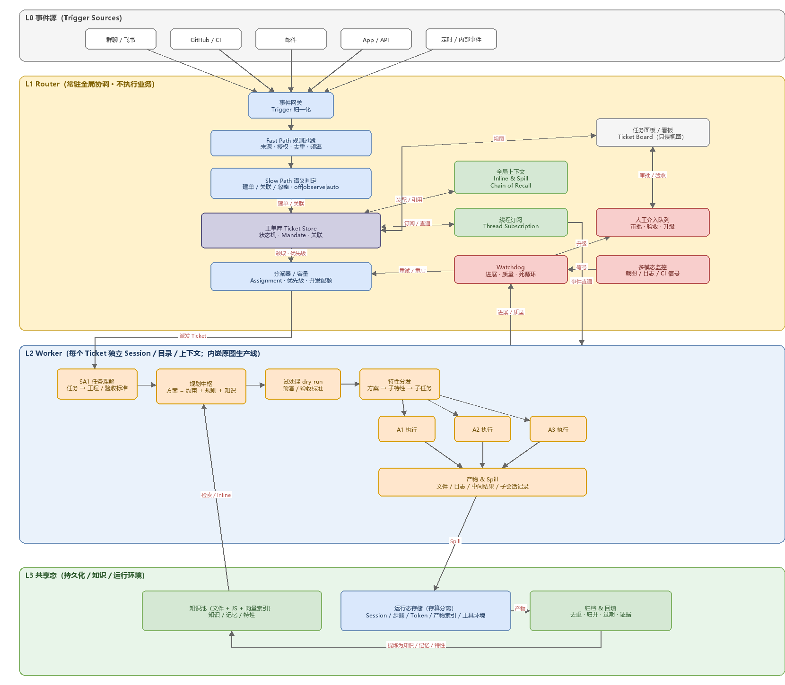

# 融合方案：把「生产线」装进 Super-agent

> 输入：`架构流程图.drawio.html`（T0–T5 生产线）+ DeepSeek Harness 的 Super-agent（Router/Worker 双层）
> 产出：`Superagent融合架构.drawio`（可编辑图）/ `Superagent融合架构.png`（预览图）

---

## 0. 一页结论

| | 原图 | Super-agent | 融合后 |
|---|---|---|---|
| 解决的问题 | 一个任务怎么被拆开、执行、沉淀 | 任务从哪来、谁授权、多任务怎么并存、失败了怎么恢复 | 两层合一：任务间调度 + 任务内生产线 |
| 基本单元 | 阶段 T0–T5 + 子特性 | Ticket / Thread / Session | Ticket 持有 Session，Session 内跑生产线 |
| 控制者 | SA1 / SA2 / 中枢 | Router（只协调不执行） | Router 管"要不要做、谁来做、到哪了"，中枢管"怎么做" |

一句话：**Super-agent 做外壳和底座（Router、工单、订阅、看门狗、持久化），原图的 SA1 + 中枢 + 试处理 + 特性分发 + A1–A3 + 知识池 整体降为 Worker 的内部生产线。**

---

## 1. 融合后的四层

| 层 | 职责 | 原图对应 | 新增/上提 |
|---|---|---|---|
| **L0 事件源** | 群聊/飞书、GitHub/CI、邮件、App/API、定时与内部事件 | T0「任务下达」 | 从"人下达"扩展为多渠道事件 |
| **L1 Router（常驻）** | 归一化 → 快筛 → 慢判 → 建单 → 分派；维护工单、上下文、订阅、看门狗 | SA1 部分、SA2 部分、任务面板 | Ticket/Mandate、Fast/Slow Path、Thread Subscription、Inline & Spill、Watchdog |
| **L2 Worker（每 Ticket 一个）** | 理解 → 规划 → 试处理 → 特性分发 → 并行执行 → 产物 | T1 处理、T2、T3、T4 | 独立 Session/目录/上下文；子代理可嵌套；容量与租约 |
| **L3 共享态** | 知识池、运行态、归档回填、工具环境（存算分离） | T5 入库 | 运行态与沉淀态分离；工具环境可远程/隔离 |

**边界原则**：Router 不碰业务细节（不读代码、不写方案）；Worker 不碰全局状态（不建单、不改其他工单）。

---

## 2. 原图节点 → 融合后落位

| 原图节点 | 融合后位置 | 改造要点 |
|---|---|---|
| T0 任务下达 | L0 事件源 + L1 事件网关 | 加 Trigger 归一化（来源/人/线程/授权范围），保留"人显式下达"作为最高优先级来源 |
| SA1 任务 | L1 Slow Path 的成单判定 | 保留"任务 → 工程"的理解能力，产出 Ticket 的 goal、验收标准、Mandate 草案；不再直接干活 |
| SA2 监控 | L1 Watchdog + 工单状态机 | 从"事后回写"改为"进展/质量门禁"，按 ticket 粒度判断是否继续 |
| 分式处理中枢 | L2 规划中枢 | 输入加：知识池检索结果、Mandate 约束、验收标准；输出：方案 + 子特性清单 + 每项验收口径 |
| T2 试处理 / 任务面板 | Ticket Board（只读视图）+ Worker 内 dry-run | 任务面板上提为工单视图，不再当流程节点；"试处理"保留为方案预演（低成本失败） |
| 特性分发 | L2 特性分发 | 生成子特性 → 子任务 → 子会话；每项带独立验收口径、预算和依赖 |
| A1/A2/A3 | L2 执行体（子会话/子代理） | 数量动态、上下文隔离、受并发配额与租约约束；可再调 Subagent |
| 知识池（文件 JS） | L3 沉淀态 + Worker 私有 Spill | 保留文件/JS 形态，补 schema、索引、摘要、证据与生命周期 |
| 多模态监控 | L1 信号源 → Watchdog | 截图/日志/CI 信号作为进展与质量证据，不再直接往知识池灌 |

---

## 3. Super-agent 六个机制怎么接

### 3.1 Fast Path / Slow Path
- **Fast Path（规则）**：来源白名单、是否 @/显式、事件类型、授权范围、去重与频率。拦掉 80% 噪声，不调模型。
- **Slow Path（模型）**：判断"建新单 / 关联已有单 / 忽略"。原图的 T2「试处理」正好可以承担 slow path 的语义沙盘——先在只读沙盘里判断值不值得做。
- 主动模式三档：`off`（只被动）/ `observe`（可评估不建单，默认）/ `auto`（规则命中才建单，且有预算上限）。

### 3.2 Ticket + Mandate
- 原图的"任务面板"是松散白板；改成**持久化工单**：状态、owner、来源事件、授权范围、验收标准、产物、依赖、截止。
- **Mandate** 是不可变授权：允许碰哪些仓库/路径/系统、可用哪些工具、token/时长/次数预算、批准人、过期时间。
- 工单状态机：
  `received → filtered → candidate → authorized → assigned → running → review → done / failed / cancelled / blocked`
  人介入点只有三处：**授权**（authorized）、**验收**（review）、**升级**（blocked/escalated）。

### 3.3 Thread Subscription（原图缺失）
- 一个工单开始执行后，**同 Thread 的后续事件直通 Worker**，不再每次过 Router 的模型判断。
- 收益：省 Router 调用、避免同一任务在多个 Session 反复重建上下文。
- 代价：订阅生命周期与关联错误要管（thread 关闭即退订、错关联要能摘除）。

### 3.4 Inline & Spill + Chain of Recall
- 原图"知识池 → 任务面板"是一次粗回灌。升级为**按需装配**：
  - **Inline**：当前 ticket 摘要、当前步骤、最近产物、相关 thread、Mandate、验收标准；
  - **Spill**：全量历史、原始日志、大文件、知识条目 → 落文件/DB，上下文只留摘要与引用；
  - **Chain of Recall**：Trigger → Thread → Ticket → Session → Artifact 逐级回捞。
- 判断标准：上下文里只放"下一步要用"的，其余靠引用按需拉。

### 3.5 Watchdog
- 原图 SA2 与多模态监控都是"数据回写"，不是"门禁"。升级为独立看门狗，三类检测：
  1. **无进展**：步数/token/时长停滞；
  2. **循环**：重复工具调用、反复改同一处；
  3. **偏航**：产物偏离验收标准、超出 Mandate。
- 动作：重试 → 换方案 → 换 Worker → 降级 → 人工。

### 3.6 持久化 / 恢复 / 存算分离
- 除知识池外，必须有**运行态**：Session、步骤、token、产物索引、状态快照。
- 失败处理分两类：**确定性重试**（网络/工具瞬时错误）与**语义重试**（换方案），二者分开计次。
- 存算分离：状态与知识在持久层，工具执行在隔离环境；Worker 换机器不丢任务。

---

## 4. 数据模型

| 对象 | 作用 | 关键字段 |
|---|---|---|
| Trigger | 归一化后的外部事件 | id、source、channel、actor、thread_id、event_type、payload_ref、dedup_key、received_at |
| Thread | 同一讨论/工作事项 | id、关联 trigger/ticket、订阅状态、参与人 |
| Ticket | 唯一执行单元 | id、goal、status、priority、mandate_id、source_trigger、acceptance、artifacts[]、worker_id、时间戳 |
| Mandate | 不可变授权 | scope(仓库/路径/工具/网络)、budget(tokens/时长/次数)、approver、expires |
| Assignment | 一次具体执行安排 | ticket_id、worker_id、session_id、workdir、lease(租约)、capacity |
| Session | 执行上下文与历史 | 上下文快照、步骤、token、产物索引、状态 |
| Artifact | 产物 | 路径、类型、hash、摘要、所属 ticket、可见范围 |
| KnowledgeEntry | 沉淀的知识/记忆/特性 | 类型、来源 ticket、证据、置信度、标签、embedding_ref、有效期 |
| Signal | 监控信号 | 来源（截图/日志/CI）、关联 ticket、严重度、处理状态 |

---

## 5. 三条关键流程

### A. 事件 → 成单 → 派发
1. 事件进网关，归一化为 Trigger（去重）；
2. Fast Path 规则筛掉噪声；
3. Slow Path 判定：建新单 / 关联已有单 / 忽略；
4. 生成 Ticket（goal + 验收标准草案）；
5. 计算 Mandate（谁授权、能做什么、预算多少）；
6. 人工或规则批准 → `authorized`；
7. 按优先级/容量分派 Assignment（租约）；
8. Worker 创建独立 Session/目录；
9. 注册 Thread 订阅；
10. 通知来源渠道"已接单"。

### B. Worker 内生产线
1. SA1 任务理解：任务 → 工程（可验收的中间物）；
2. 规划中枢：检索知识池 + 套 Mandate 约束 + 框架规则 → 方案；
3. 试处理 dry-run：低成本预演，暴露方案缺陷；
4. 特性分发：拆子特性 → 子任务（带验收口径/预算/依赖）；
5. 并行执行：A1–A3（可再调 Subagent）；
6. 产物落盘（Spill）；
7. 自检：按子任务验收口径逐项核对；
8. 提交 review（结果 + 证据 + 差异说明）。

### C. 回流 / 治理 / 恢复
1. 产物索引写入运行态；
2. 归档 & 回填：去重、归并、打证据、设有效期；
3. 知识池更新（知识/记忆/特性）；
4. 看板更新工单状态与产物视图；
5. Watchdog 复核：无进展/循环/偏航 → 重试或升级；
6. 人工验收 → done；失败 → failed（留原因与可复用教训）。

---

## 6. 知识池：从"文件堆"到"双层知识体系"

| | 运行态（state） | 沉淀态（pool） |
|---|---|---|
| 存什么 | Session、步骤、token、产物索引、工具环境 | 知识、记忆、特性、案例、规则 |
| 生命周期 | 短，任务结束可归档/清理 | 长，有置信度、证据、有效期 |
| 谁读 | Worker 自己、Watchdog | 规划中枢、SA1、Router（摘要级） |
| 谁写 | 执行过程自动写 | 验收通过后由归档&回填写入 |

- 写入路径：`产物 → 归档&回填（去重/归并/过期/证据）→ 知识池`；
- 读出路径：`知识池 → 检索 → 摘要/引用进上下文（Inline），全文留 Spill`；
- 条目标签至少包含：类型（知识/记忆/特性）、来源 ticket、证据、置信度、有效期、适用场景。

---

## 7. 权限与安全（Super-agent 的已知短板）

- **Session 隔离 ≠ 权限隔离**：公开原型的 Worker 以 danger-full-access、同 OS 用户执行，目录约束挡不住越权。融合方案必须补：
  - 独立执行身份 / 容器 / 沙箱；
  - Mandate 最小权限 + **写盘前 fail-closed 闸**（未授权即 BLOCK）；
  - 凭据短期化：按 ticket 发放、用完即焚；
  - append-only 审计：谁授权、谁执行、动了什么、为什么。
- 主动能力默认 `observe`；`auto` 必须"规则命中 + 预算内 + 可回滚"三条件同时满足。

---

## 8. 监控与恢复

| 检测 | 信号 | 动作 |
|---|---|---|
| 无进展 | 步数/token/时长停滞 | 换策略 → 换 Worker → 升级 |
| 循环 | 重复工具调用、同一处反复改 | 打断 + 强制重规划 |
| 偏航 | 产物偏离验收标准/超 Mandate | 暂停 + 人工确认 |
| 预算 | token/时长/次数超限 | 熔断 + 降级 |

恢复顺序：**确定性重试 → 语义重试（换方案）→ 换 Worker → 降级 → 人工**，每级都要计数与留痕。

---

## 9. 落地路线

| 里程碑 | 周期 | 范围 | 验收标准 |
|---|---|---|---|
| **M0 骨架** | 1–2 周 | 工单表 + 事件入口 + Fast Path + 手工派发；现有 T0–T5 脚本化跑通；知识池定 schema | 一条事件能走完"建单→派发→执行→回填"，状态可查 |
| **M1 生产线** | 3–4 周 | Worker 独立 Session/目录；特性分发并行；Ticket Board；产物索引 | 3 个并行 Worker 互不串上下文；看板可追产物 |
| **M2 自主化** | 4–6 周 | Thread Subscription；Inline & Spill；Watchdog；权限沙箱；observe/auto | 无人 @ 也能识别并处理高置信事件；异常可自动恢复或升级 |
| M3（可选） | — | 存算分离、BYOM、多租户、跨设备 | 换机不丢任务；多团队隔离 |

---

## 10. 指标

- **任务**：p50/p95 完成时间、一次通过率、返工率、返工原因分布；
- **调度**：自动接单准确率、误触发率、人工介入率、并发利用率、排队时长；
- **成本**：单任务 token（含 cache-read）、工具调用次数、单位产出成本；
- **质量**：看门狗拦截率、升级率、回归率、知识条目复用率。

> 参考 Super-agent 官方实验：双层结构 p50 12.4min / p95 15.7min；单会话 + Subagent 普通提示为 20.4/29.5min；代价是 cache-read tokens 从 6.1M 涨到 23.2M——**用算力和 token 换并发与长尾稳定性**，融合方案要沿用这个取舍。

---

## 11. 不要做的事（反模式）

1. 把 Router 做成第二个"业务大脑"（读代码、写方案）→ 必然成为瓶颈；
2. 把所有知识/历史塞进上下文 → 上下文爆炸、成本失控；
3. 让任务面板/看板变成流程节点 → 状态双写、事实不一致；
4. 没有授权模型就开 `auto` → 误触发、越权执行；
5. 多个 Worker 共享目录或上下文 → 串味、互相覆盖；
6. 把"特性"拆到无法独立验收的粒度 → 进度黑箱、无法汇总；
7. 只做监控不做门禁（只回写知识池）→ 问题被发现时已经太晚。

---

## 12. 与开源 superagent 框架的关系

若你指的是 `superagent-ai/superagent`（助手应用框架：RAG、工具、工作流、Assistants API）：它和本图不在同一层。融合方式是——**它做 Worker 内部的能力件**（把知识池换成它的 vectorstore/RAG，把 A1–A3 换成它的 workflow 节点），**Router/工单/调度仍由 Super-agent 这层负责**。

---

## 参考

- [DeepSeek Super-agent 设计公开报道](https://www.wicongress.org.cn/zbh/system/2026/11/03/030003313.shtml)
- [DeepSeek Super-agent 架构解析（Router/Worker、Ticket、Thread Subscription、实验数据）](https://developer.aliyun.com/article/1779111)
- [Super-agent 开源原型说明（dsh-superagent-prototype）](https://news.qiniu.com/archives/1793499698327)
- [dsh-superagent coding agent 报道](https://dataconomy.com/2026/11/02/deepseek-releases-open-source-dsh-superagent-coding-agent/)
